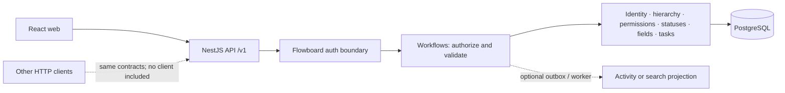

# Flowboard

Flowboard is a collaborative work management app. It organizes work into workspaces, spaces, folders, and lists, where teams can manage tasks with scoped statuses, custom fields, and access rules.

## Tech stack

- **Web:** React, TypeScript, and Ant Design
- **API:** NestJS and TypeScript, structured as a modular monolith
- **Data:** PostgreSQL and Prisma
- **Local runtime:** Docker Compose, with separate web, API, and database services

## Run locally

Requirements: Docker Desktop (or Docker Engine with Compose) and Git. From the repository root:

```bash
docker compose up --build
```

Open the app at [http://localhost:8080](http://localhost:8080). The API is at [http://localhost:3000](http://localhost:3000), and its Swagger UI is at [http://localhost:3000/docs](http://localhost:3000/docs).

Demo accounts use `FlowboardDemo!2026` by default: `alice@flowboard.com`, `bob@flowboard.com`, and `carol@flowboard.com`. These are development-only credentials.

Stop the services with `Ctrl+C`, or run `docker compose down`. To also remove the local database volume and its data, run `docker compose down -v`.

For an optional short-lived hosted demo using Render and Neon, see the [deployment guide](docs/deployment.md).

## Connect a local database client

PostgreSQL stays on Compose's internal network by default. To connect a desktop database client, create an untracked `compose.override.yml` in the repository root:

```yaml
services:
  db:
    networks:
      - internal
      - db-access
    ports:
      - '127.0.0.1:5433:5432'

networks:
  db-access:
```

Compose loads the override automatically. Connect with:

```text
Host:     127.0.0.1
Port:     5433
Database: flowboard
User:     flowboard
Password: flowboard
SSL:      disabled
```

The port is bound to this computer only. If `5433` is already in use, change the host-side port and use that value in your client. The override is ignored by Git; remove it when you no longer need host access.

## System design

The web app and API are separate Docker services. The API is a modular monolith; it authenticates requests, applies permissions and business rules through workflows, and reads/writes PostgreSQL through domain-owned repositories. Status and custom-field configuration resolve against the workspace hierarchy.



The API enforces access checks and resolves effective configuration; the browser only owns presentation state. The [architecture guide](docs/architecture.md) has the trust boundaries, request flows, module dependencies, and growth plan.

## Data model

Tasks live in lists within a workspace → space → folder → list hierarchy. A list uses the closest ancestor status set that is defined (workspace default, then space/folder/list override). Custom fields accumulate from space through folder to list; keys are unique across the workspace, so a child cannot override a parent field. The server validates task status and field values against the destination list's resolved configuration, including when moving a task.

See the [ER reference](docs/er-diagram.md) for tables and relationships, and the [status](docs/modules/statuses.md) and [custom-field](docs/modules/custom-fields.md) guides for resolution and validation rules.

## API and authentication

The API uses versioned REST routes under `/v1`, resource-oriented URLs and HTTP verbs, a shared JSON error envelope, and offset/limit pagination for collections. The running API's [Swagger UI](http://localhost:3000/docs) is the route reference; its DTO and security metadata are incomplete. See [API conventions](docs/modules/api-contracts.md).

Users sign in with local credentials. The API issues Flowboard access JWTs and rotating refresh cookies, then resolves current membership and permissions server-side; it does not trust a role supplied by a client. The web UI is the primary channel; a separate curl or CLI client is not included. Any CLI or webhook adapter must call shared workflows and enforce the same authorization rules. See [identity](docs/modules/identity.md) and [channel boundaries](docs/architecture.md).

## Scalability and trade-offs

The API is designed to be stateless across requests, with PostgreSQL as shared state; production startup would run migrations once before API replicas. Workspace-level write locking is a throughput limit. The MVP has no queue, worker, cache, search, or live updates. Activity or search processing could use a transactional outbox and worker with retries, idempotent consumers, and eventually consistent projections if asynchronous processing is needed.

To keep the MVP focused, bulk edits, search, live updates, and a separate CLI were cut. Application tests are documented in the [test plan](docs/test-plan.md); API and channel details are in the [contract guide](docs/modules/api-contracts.md). Measure tree and board query load before adding infrastructure or extracting activity/search processing. More on current limits and IPC options is in [ADR-0005](docs/adr/0005-delivery-and-consistency.md).

## Checks

```bash
make test  # isolated PostgreSQL API tests and browser journeys in Docker
yarn lint
yarn typecheck
yarn format:check
```

## Project documentation

The [`docs/`](docs/README.md) directory is the reference for deeper project design and behavior:

- **Product:** assignment brief, requirements, and test plan.
- **System design:** architecture, workflows, and data model.
- **Decisions:** ADRs that explain key design choices.
- **Modules:** focused guides for each part of the application.
- **Reference:** glossary and documentation change guide.

Use the [documentation hub](docs/README.md) to find a specific guide.
