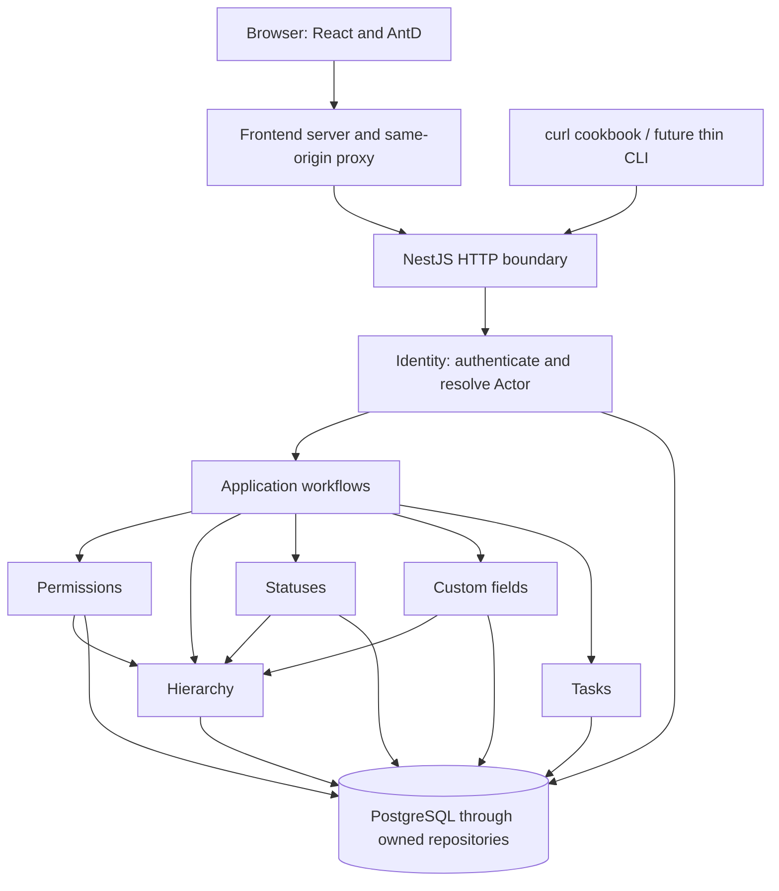

# Application architecture

Status: planned. Navigation: [hub](README.md), [ER reference](er-diagram.md).

## 1. The application in everyday language

Flowboard is a shared filing system for work. Containers organize it, lists hold tasks, and each person sees only the branches they may access. A list borrows configuration from its ancestors unless it has its own status set. Additional task fields accumulate from ancestors.

The application runs as three services: a React website, one NestJS API, and PostgreSQL. The API is one deployed program with clearly separated libraries: a modular monolith. A library boundary is not a network call or a separate service.



## 2. Trust boundaries and ownership

Browser inputs are untrusted, including user IDs, role-like fields, status keys, custom values, and versions. The API verifies Flowboard tokens, loads current membership, and checks resource access. PostgreSQL is reachable only on the internal Compose network. Passwords and tokens never belong in logs or domain DTOs.

Every repository is owned by one module. Having a shared database does not authorize a module to query a sibling's tables. Workflows call public module methods and share a transaction context when an operation must be atomic. Foreign keys may cross ownership boundaries; repository access may not.

| Owner         | Tables                                                                                         |
| ------------- | ---------------------------------------------------------------------------------------------- |
| Identity      | USERS, AUTH_IDENTITIES, USER_CREDENTIALS, WORKSPACE_MEMBERSHIPS, AUTH_SESSIONS, REFRESH_TOKENS |
| Hierarchy     | WORKSPACES, CONTAINERS                                                                         |
| Permissions   | CONTAINER_GRANTS                                                                               |
| Statuses      | STATUS_SETS, STATUSES                                                                          |
| Custom fields | CUSTOM_FIELD_DEFINITIONS, CUSTOM_FIELD_OPTIONS                                                 |
| Tasks         | TASKS, TASK_ASSIGNEES, TASK_FIELD_VALUES                                                       |

## 3. Allowed dependencies

The following graph is the planned import policy, not a diagram of database joins. `contracts` is framework-neutral; `persistence` exposes infrastructure, not sibling repositories.

<!-- dependency-policy:start -->

```json
{
  "web": ["contracts"],
  "api": ["identity", "workflows", "persistence", "contracts"],
  "workflows": [
    "identity",
    "hierarchy",
    "permissions",
    "statuses",
    "custom-fields",
    "tasks",
    "persistence",
    "contracts"
  ],
  "identity": ["persistence", "contracts"],
  "hierarchy": ["persistence", "contracts"],
  "permissions": ["hierarchy", "persistence", "contracts"],
  "statuses": ["hierarchy", "persistence", "contracts"],
  "custom-fields": ["hierarchy", "persistence", "contracts"],
  "tasks": ["persistence", "contracts"],
  "persistence": [],
  "contracts": []
}
```

<!-- dependency-policy:end -->

The API root wires infrastructure and controllers. Domain controllers delegate to application workflows. Identity owns its own authentication endpoints. A task/config write must not bypass a workflow by invoking a repository directly. Workflows use identity to refresh an Actor inside a write transaction; identity never imports workflows.

The web UI is the primary client. A curl cookbook is the lightweight second channel for the MVP; a thin CLI may replace or wrap those requests later. Both channels use the same `/v1` routes, Flowboard authentication, request/response contracts, permission checks, and workflows. Domain behavior must not depend on React state, browser headers, or a web-only controller. The future CLI needs only an HTTP adapter for sign-in, cookie handling, Bearer requests, and output formatting; it does not need a second set of domain APIs or repositories. No CLI executable is part of Day 2.

### Channel boundaries

| Channel                                        | Contract and authentication                                                                                                                                                                                                                                | Channel-owned behavior                                                                                   |
| ---------------------------------------------- | ---------------------------------------------------------------------------------------------------------------------------------------------------------------------------------------------------------------------------------------------------------- | -------------------------------------------------------------------------------------------------------- |
| Web UI, primary                                | Calls `/v1` with Flowboard access JWT and browser refresh cookie; server resolves the Actor and permissions.                                                                                                                                               | Navigation, selected list, board/table toggle, drawer, drag interaction, loading and error presentation. |
| Curl cookbook, MVP secondary; thin CLI, future | Calls the same `/v1` routes with the same Flowboard login, Bearer token, validation, and error contracts; a cookie jar can carry refresh.                                                                                                                  | Command arguments and output formatting; no domain rules or repository access.                           |
| Incoming webhook, future                       | A separately versioned webhook payload and verified sender must map to an explicitly authorized internal principal before invoking the same application workflows. It does not inherit a user's browser session or become a shortcut around access checks. | Transport verification and payload translation; no task/config business rules.                           |
| Outgoing webhook, future                       | A versioned event payload would describe committed changes; signing, delivery, retry, and failure policy need a separate design. It does not use the `/v1` request/response DTO as its event contract.                                                     | Delivery to subscribers; no browser UI state.                                                            |

Webhook direction, identity mapping, event schemas, and delivery guarantees require a separately scoped design before implementation. There are no webhook endpoints, subscriptions, or delivery workers in the MVP. The shared boundary is domain behavior and authorization inside workflows; transport and presentation stay with each channel.

Frontend features may depend on contracts and their own UI helpers. They cannot import backend libraries. External auth SDK imports are restricted to identity. Nx project tags, module-boundary lint rules, public entry points, and cycle checks enforce the policy when code is added.

## 4. Boundaries during common actions

| Action             | Route through the system                                                                                        |
| ------------------ | --------------------------------------------------------------------------------------------------------------- |
| Login              | Web -> identity verifier -> shared session/token service -> response                                            |
| Load Work overview | HTTP auth -> workflow -> filtered hierarchy/permissions -> task-owned aggregate queries in one read snapshot    |
| Load a board       | HTTP auth -> workflows -> hierarchy/permissions -> status/field resolvers -> task query                         |
| Drag a card        | HTTP auth -> workspace transaction -> fresh membership/access/config -> task placement write                    |
| Move between lists | Same transaction checks source/destination, destination status/fields, then task/values/order writes            |
| Edit configuration | Admin workflow builds a candidate, checks affected lists/tasks through public services, then commits or rejects |

The [workflows guide](modules/workflows.md) provides sequence diagrams and rollback paths. The [identity guide](modules/identity.md) shows the local/SSO convergence and session family behavior.

## 5. Growth story and deliberate trade-offs

API processes use PostgreSQL session state and provisioned shared signing material, so no sticky sessions are required. A session lookup gives immediate revocation at the cost of a database read. Domain writes initially serialize on the workspace row; correctness is more important than peak write throughput for 24 seeded tasks. Login throttling is per API instance in the MVP and needs shared edge enforcement before production horizontal scaling.

The first future extraction candidate is activity/search, when asynchronous workloads justify it. The proposed path is task transaction -> outbox -> worker -> projection, with event IDs, version-aware consumers, retries, deduplication, dead-letter handling, and eventual consistency. No worker/queue/outbox business table is part of this MVP. See [ADR-0005](adr/0005-delivery-and-consistency.md).
