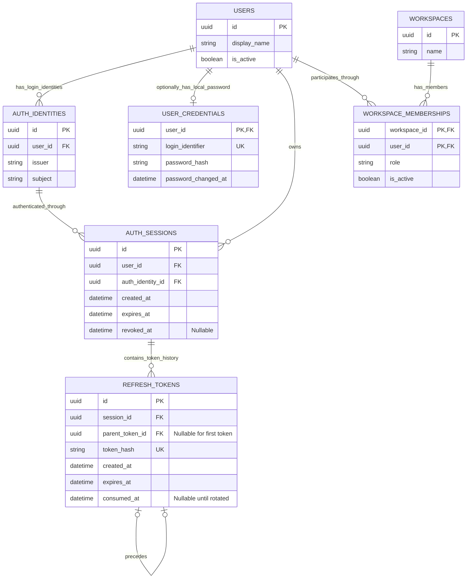
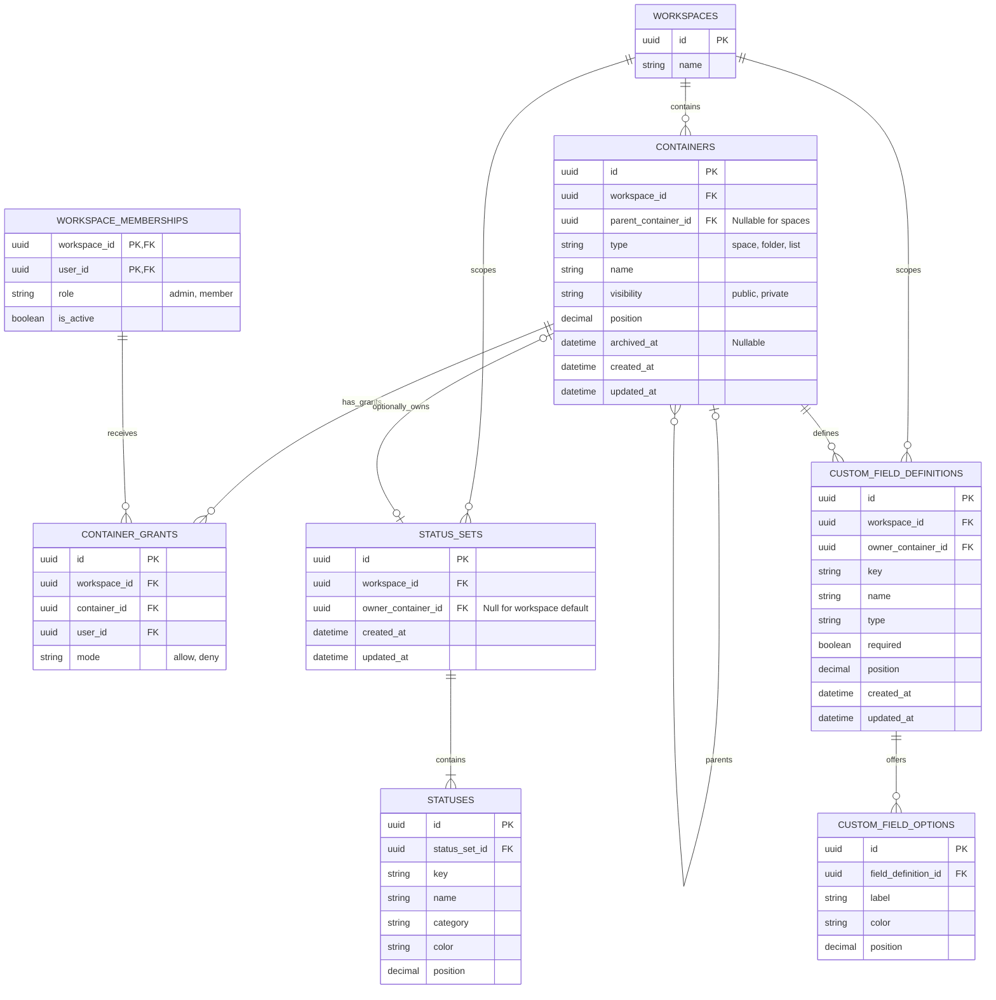
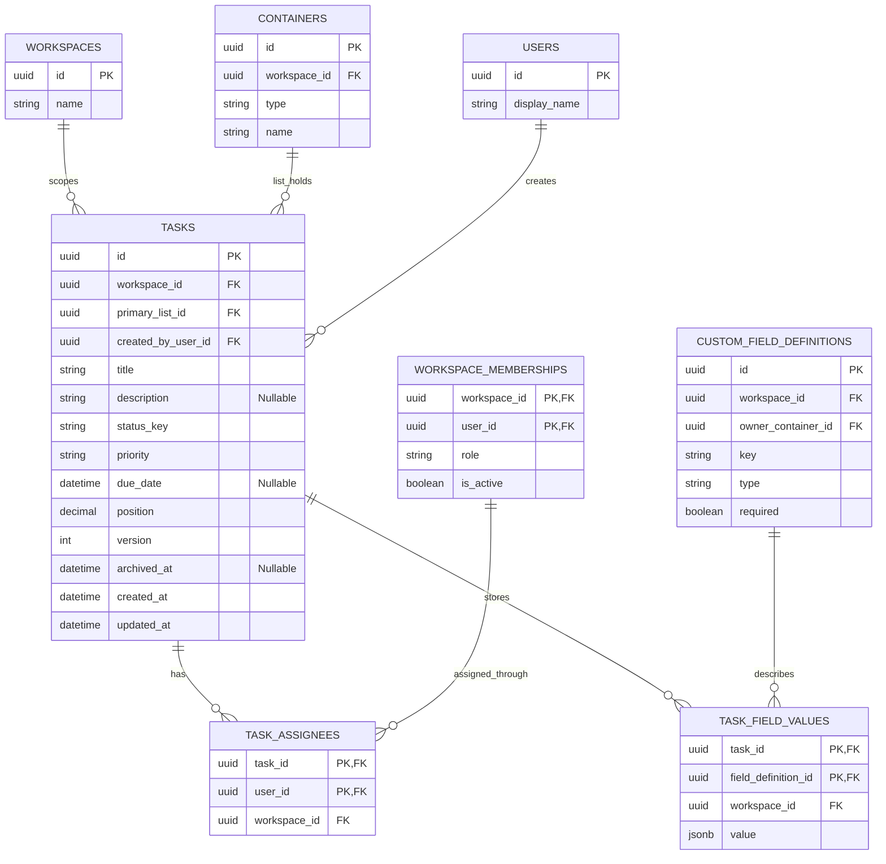
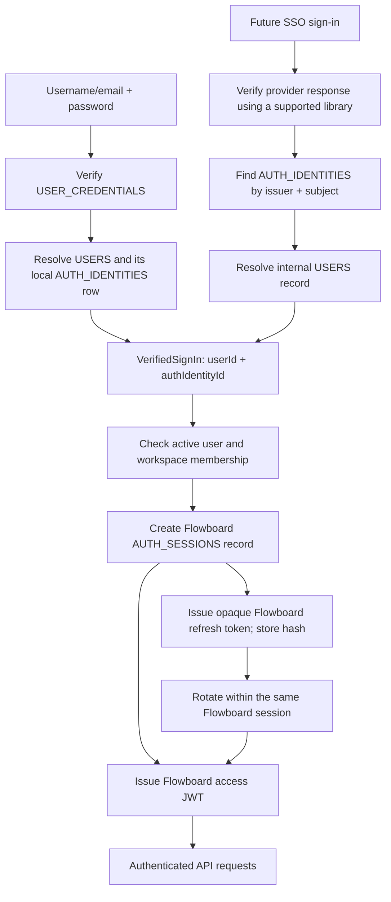

# Historical planning snapshot

Archived on 2026-10-20 before modularization. This file is historical evidence, not an implementation specification. Use [the documentation hub](../README.md) and its owning module documents.

---

# Flowboard implementation plan

Status: planning; application implementation has not started.

Updated: 2026-10-20. This document replaces earlier chat plans where they differ.

## 1. Goal, scope, and architectural decisions

Build the assignment's single-workspace project-management application: hierarchy, tasks, inherited statuses, custom fields, kanban/list views, permissions, persistence, Docker startup, tests, and documentation. The assignment PDF is the requirements source; the supplied diagrams are the accepted authentication design. Implementation choices below are our decisions, rather than additional instructions from the source material.

### Reference reconciliation

The supplied authentication references are preserved here:

- [Identity and membership ER reference](../references/auth-identity-er.png).
- [Session and refresh-token ER reference](../references/session-token-er.png).
- [Shared local/SSO sign-in flow reference](../references/shared-sign-in-flow.png).

| Previously inconsistent detail                                     | Authoritative decision                                                                                         |
| ------------------------------------------------------------------ | -------------------------------------------------------------------------------------------------------------- |
| Credentials attached to an auth identity                           | `USER_CREDENTIALS.user_id` is its PK and FK to `USERS.id`. There is no `auth_identity_id` in this table.       |
| An external provider replacing Flowboard's session/token machinery | Local and future SSO verification converge before the same Flowboard session creation and token issuance.      |
| Extra refresh-token revocation state                               | Session revocation is authoritative. `REFRESH_TOKENS` has no `revoked_at` column.                              |
| Extra session revocation-reason state                              | Use the reference's nullable `AUTH_SESSIONS.revoked_at`; do not add a revocation-reason column in this schema. |
| Missing explanation for a local session's identity                 | Seed a local `AUTH_IDENTITIES` mapping for each local user, and record that identity on local sessions.        |

These corrections preserve the reference tables' columns and relationships. Do not silently change these relationships in migrations, DTOs, implementation, or later diagrams. Additional auth columns or a provider-token-based API would require an explicit ADR revision.

### Stack and boundaries

| Area            | Decision                                                                                                      |
| --------------- | ------------------------------------------------------------------------------------------------------------- |
| Monorepo        | Nx with Yarn Workspaces; domain libraries are separate Nx projects.                                           |
| Package manager | Yarn 4, exact version pinned, one root `yarn.lock`, `nodeLinker: node-modules`, immutable CI/Docker installs. |
| Frontend        | React, TypeScript, Vite, Ant Design, React Router, TanStack Query, dnd-kit.                                   |
| Backend         | NestJS modular monolith.                                                                                      |
| Persistence     | PostgreSQL, Prisma, checked-in migrations, SQL constraints where Prisma alone cannot express them.            |
| Authentication  | Seeded-user password login, Flowboard JWT access tokens, database sessions, opaque rotating refresh tokens.   |
| Authorization   | Database-owned workspace roles and ancestor-aware container grants.                                           |
| Runtime         | Three Compose services: web, API, database; no required cache, worker, queue, or external identity account.   |
| Tests           | Document scenarios during feature development; implement required tests after feature freeze.                 |

```text
apps/
  web/
  api/
libs/
  api/
    identity/
    hierarchy/
    permissions/
    statuses/
    custom-fields/
    tasks/
    workflows/
    persistence/
  shared/
    contracts/
docs/
  implementation-plan.md
  knowledge-hub.md        (created during Day 1)
  adr/                    (created during Day 1)
  test-plan.md            (created during Day 1)
  references/
```

| Library       | Ownership                                                                                                             |
| ------------- | --------------------------------------------------------------------------------------------------------------------- |
| Identity      | Users, credentials, identity links, sign-in verification, sessions, access/refresh tokens, trusted caller resolution. |
| Hierarchy     | Containers, valid ancestry, sibling ordering, archival.                                                               |
| Permissions   | Grants and visibility/access decisions.                                                                               |
| Statuses      | Status sets, definitions, resolution, config validation.                                                              |
| Custom fields | Definitions, select options, schema resolution, typed validation.                                                     |
| Tasks         | Tasks, assignments, custom values, placement.                                                                         |
| Workflows     | Cross-domain authorization, validation, and atomic mutations.                                                         |
| Persistence   | Connection and transaction coordination; each domain retains its own repositories.                                    |

Use Nx project tags, `@nx/enforce-module-boundaries`, public-entry-point import restrictions, and cycle checks. Domain libraries cannot read sibling tables directly. Cross-domain checks are coordinated through exported services, with a shared transaction context when necessary. Provider SDKs and token implementation details stay within identity. Shared contracts contain API types/enums, without ORM or provider types.

The four-day target is approximately 32 focused hours. Real authentication adds risk to this budget; reserve explicit time for it and reduce visual polish before dropping required validation or tests. Signup, password recovery, email verification, MFA, subtasks, cross-list aggregate boards, search, real-time updates, activity feeds, generated clients, and hosted deployment are not scheduled.

## 2. Authoritative 16-table ER model

Repeated entities across views are the same tables. The business tables are:

| Group                       | Tables                                                                            |
| --------------------------- | --------------------------------------------------------------------------------- |
| Identity and authentication | `USERS`, `AUTH_IDENTITIES`, `USER_CREDENTIALS`, `AUTH_SESSIONS`, `REFRESH_TOKENS` |
| Membership and hierarchy    | `WORKSPACES`, `WORKSPACE_MEMBERSHIPS`, `CONTAINERS`, `CONTAINER_GRANTS`           |
| Configuration               | `STATUS_SETS`, `STATUSES`, `CUSTOM_FIELD_DEFINITIONS`, `CUSTOM_FIELD_OPTIONS`     |
| Tasks                       | `TASKS`, `TASK_ASSIGNEES`, `TASK_FIELD_VALUES`                                    |

Migration history and seed-version markers are technical bookkeeping outside these 16 business tables. Persist datetime values as UTC PostgreSQL `timestamptz`; custom date fields use validated `YYYY-MM-DD` values.

### A. Identity, credentials, sessions, and membership

This view follows the supplied ER references, including the direct user-to-credentials relationship and the exact session/token columns.



### B. Hierarchy, permissions, and configuration



Workspace is a separate root record. Spaces, folders, and lists share `CONTAINERS`, giving grants and configuration real foreign keys instead of polymorphic owner references. The API derives `ownerType` from the container type.

A space has no parent container and belongs to its workspace through `workspace_id`; the tree API exposes the workspace as its logical parent. Enforce the strict shape workspace -> space -> folder -> list. A status-set owner is either a space/folder/list or null for the workspace default. Field definitions and grants attach only to space/folder/list containers.

### C. Tasks, assignments, and custom values



Tasks reference exactly one list. The workflow checks the referenced container's type. `status_key` deliberately has no direct FK to `STATUSES`: validate it against the task list's resolved set. Field-value rows reference definitions; the API maps definition keys to values. Option IDs inside JSONB are validated against their definition in application logic.

### Required constraints and ownership invariants

| Rule                                      | Enforcement                                                                                                                                                                       |
| ----------------------------------------- | --------------------------------------------------------------------------------------------------------------------------------------------------------------------------------- |
| Stable external account mapping           | Unique `(issuer, subject)`; external issuer/subject comparison follows provider semantics, without email-based linking.                                                           |
| Optional local password per user          | `USER_CREDENTIALS.user_id` PK/FK; normalized unique `login_identifier`.                                                                                                           |
| Exactly one local identity per local user | Partial unique index on `AUTH_IDENTITIES.user_id` for fixed issuer `urn:flowboard:local`; subject is the internal user UUID string. External identities may be multiple per user. |
| Session identity belongs to session user  | Composite FK `(auth_identity_id, user_id)` -> `AUTH_IDENTITIES(id, user_id)`, with a supporting unique key. Both session references are non-null.                                 |
| Token chain stays within one session      | Composite parent FK `(parent_token_id, session_id)` -> `REFRESH_TOKENS(id, session_id)`; unique non-null `parent_token_id`; immutable parent after insertion.                     |
| Expiry and rotation history               | Session/token expiry follows creation; token expiry never exceeds session expiry; one atomic consumption and successor creation.                                                  |
| Refresh secret storage                    | Unique `token_hash`; never store raw refresh tokens or access tokens.                                                                                                             |
| Membership and grants                     | Composite membership PK; grants reference membership and container in the same workspace; one grant per `(workspace_id, container_id, user_id)`.                                  |
| Status configuration                      | One local set per non-null owner and one default per workspace using partial unique constraints; unique status key within each set.                                               |
| Field configuration                       | Unique immutable `(workspace_id, key)`; options reference their field.                                                                                                            |
| Task relations                            | Composite PKs for assignments and field values; same-workspace composite FKs for parent/list/task/member/definition references, with supporting unique keys.                      |

Cross-row rules such as parent types, minimum status categories, and effective schemas are enforced inside application transactions. Normal lifecycle operations archive or revoke rather than cascade-delete business records. Retain consumed token history while its session can still be replayed; later cleanup must not remove active-session replay evidence.

## 3. Authentication flow and business behavior

### Shared sign-in flow: local now, SSO later

Both methods resolve the same pair of internal identifiers before creating a session. This is the convergence boundary shown in the user's reference.



```ts
type VerifiedSignIn = {
  userId: string;
  authIdentityId: string;
};

type Actor = {
  userId: string;
  workspaceId: string;
  role: 'admin' | 'member';
};
```

Local verification reads credentials by normalized login identifier, verifies the hash, and resolves the user. It then loads that user's pre-provisioned local identity to populate the required session FK. Missing local identity is a provisioning/configuration error; fail closed rather than creating mismatched or anonymous sessions. Seeding creates credentials and the local identity consistently.

Future SSO verification validates the provider response and resolves a pre-linked `(issuer, subject)` identity. An unknown mapping is denied; no email-based auto-linking or automatic provisioning. An SSO-only user can have zero credentials rows. Use a supported OIDC client library for authorization-code/PKCE, state, nonce, and provider validation when SSO is implemented. See [OIDC Core](https://openid.net/specs/openid-connect-core-1_0.html).

Both branches call the same session-creation/token-issuance service. Domain APIs continue accepting Flowboard access tokens for both methods. Provider ID/access/refresh tokens do not become domain API credentials and are not stored in `REFRESH_TOKENS`. Do not create a separate SSO session implementation.

The MVP implements local verification and the shared session/token machinery. SSO is a documented future adapter plus a test-double substitution scenario, not a shipping provider integration. Adding SSO changes sign-in integration and identity mapping, not the database business references, application session system, refresh flow, or permission engine. Existing local sessions need not be invalidated merely to enable SSO alongside local login; a later deliberate local-login retirement defines revocation policy separately.

### Password login, access tokens, and session defaults

| Concern                | Decision                                                                                                                                                    |
| ---------------------- | ----------------------------------------------------------------------------------------------------------------------------------------------------------- |
| Local sign-in          | Seeded usernames `alice`, `bob`, `carol`; normalize local identifiers by trimming and lowercasing. No registration/recovery screens.                        |
| Password storage       | Argon2id through an established library, with at least 19 MiB memory, 2 iterations, parallelism 1; verify encoded hashes and permit future rehashing.       |
| Session lifetime       | Absolute 7 days from login; refresh does not extend it.                                                                                                     |
| Access JWT             | Maximum 10 minutes, capped by remaining session lifetime; claims `sub`, `sid`, `iss`, `aud`, `iat`, `exp`, `jti`.                                           |
| JWT signing            | HS256 through an established library; at least 256-bit random secret; pin verification algorithm, issuer, audience, and expiry validation.                  |
| Refresh secret         | Opaque cryptographically random value with at least 256 bits of entropy; store only its SHA-256 hash.                                                       |
| Browser storage        | Access token in memory; refresh token in a host-only HttpOnly cookie, SameSite=Strict, path `/v1/auth`. No token persistence in localStorage.               |
| Transport              | HTTPS and Secure cookie in production; explicit local-demo mode supports HTTP Compose.                                                                      |
| Local signing material | Generate once into a named local secrets volume, reuse across restarts, and never commit/print it. Production requires provisioned shared signing material. |

Password defaults follow [OWASP password storage guidance](https://cheatsheetseries.owasp.org/cheatsheets/Password_Storage_Cheat_Sheet.html). This application uses established password/JWT libraries rather than implementing cryptographic primitives.

Invalid identifier/password returns generic `401`. Apply per-instance login throttling in the MVP, returning `429`; document shared edge/database-backed enforcement before horizontal production deployment. Never log passwords, raw tokens, cookies, or Authorization headers.

An access-request authenticator validates the Flowboard JWT and matching active session, including `sub == session.user_id`. It then resolves the session's identity/user and current active membership into `Actor`. Roles and grants come from PostgreSQL on each request, not from JWT claims. An indexed session lookup intentionally provides immediate revocation; there is no process-local session state or sticky-session requirement.

| Condition                                                                       | Result                                                                       |
| ------------------------------------------------------------------------------- | ---------------------------------------------------------------------------- |
| Missing/invalid/expired access token; expired/revoked session                   | `401`                                                                        |
| Valid credentials/identity but inactive user or membership; unknown SSO mapping | `403`                                                                        |
| Resource permission denied                                                      | `403`                                                                        |
| Identity/session persistence unavailable                                        | `503`, with no authentication fallback                                       |
| Mock `X-User-Id` header                                                         | Cannot establish identity; there is no mock authentication mode in this MVP. |

Credential maintenance that changes a password must update `password_changed_at` and revoke the user's local-identity sessions transactionally. No password-change/recovery endpoint is included in this MVP; document that invariant for maintenance and future features.

### Refresh rotation, logout, and browser behavior

On refresh, lock the session, then the matching token row inside one transaction. Check session/user/membership, token hash, expiry, and consumption. A valid refresh marks `consumed_at` and inserts one successor with `parent_token_id` pointing to the consumed row; its expiry cannot exceed the original session deadline.

If a known consumed token is presented while the session remains live, commit `AUTH_SESSIONS.revoked_at` before returning `401`. This invalidates every token in that family and access JWTs for that session. Do not throw an exception that rolls back the revocation. There is no per-refresh-row revocation column: effective validity depends on the parent session, token expiry, and `consumed_at`.

Logout revokes the current session and clears the refresh cookie; logout-all revokes all sessions for the authenticated user. Other sessions remain active after ordinary logout. Retain session and token history rather than deleting it. Rotation/replay principles are supported by [RFC 9700](https://www.rfc-editor.org/rfc/rfc9700.html); this app does not implement a general OAuth authorization server.

Serialize refresh within a tab and across tabs with Web Locks; unsupported browsers require sign-in after expiry. Use the latest cookie when executing a queued refresh. Broadcast identity/logout events, cancel outstanding requests, clear cached user data/drawers, and never replay an old user's mutation under a new user's identity. Retry an original API request at most once after successful refresh. Do not automatically retry an ambiguous refresh network failure: the server may already have consumed the token, requiring sign-in again.

Require configured allowed origins and JSON bodies for browser login and cookie-authenticated refresh/logout; reject missing/untrusted origins on those cookie-sensitive routes. The curl cookbook supplies the configured Origin and a cookie jar. Keep browser requests same-origin through the frontend proxy and avoid unnecessary CORS allowances.

| Endpoint                   | Contract                                                                                                                    |
| -------------------------- | --------------------------------------------------------------------------------------------------------------------------- |
| `POST /v1/auth/login`      | Verify credentials, create a Flowboard session, return access token/expiry/current-user identity, set refresh cookie.       |
| `POST /v1/auth/refresh`    | Rotate cookie token within the same session; return new access token/expiry/current-user identity and set successor cookie. |
| `POST /v1/auth/logout`     | Revoke current cookie-associated session and clear cookie; idempotent.                                                      |
| `POST /v1/auth/logout-all` | Require access JWT; revoke all sessions for its user and clear cookie.                                                      |
| `GET /v1/me`               | Require access JWT; return current internal user and workspace role.                                                        |

### Hierarchy, status, field, and permission rules

Each node has one parent; a parent may have multiple children. Tasks belong to exactly one primary list, never directly to a folder/space/workspace. Sibling reordering is supported; cross-parent container movement, arbitrary nesting, secondary task memberships, and subtasks are deferred. Archive containers/tasks; archived ancestors make descendants unavailable in normal reads/writes.

Statuses resolve from list -> folder -> space -> workspace default, stopping at the nearest explicit complete set. A local set replaces its ancestor. Copied local overrides do not receive subsequent ancestor edits. Every resolved set requires `not_started`, `active`, and `done`; `closed` is optional. Board columns use resolved statuses, including empty columns. Status keys are immutable; display name/color/order can change.

Fields accumulate from space -> folder -> list, with immutable workspace-unique keys and no child overrides/collisions. Edit inherited definitions at their owner. Support text, finite number, single-select option ID, distinct multi-select option IDs, valid `YYYY-MM-DD` date, and boolean checkbox. Validate resulting task state on create/update/move. Omitted values remain unchanged; `null` clears optional values by removing rows. Required fields accept `0` and `false`, but reject missing/empty required text/selections.

| Operation                                                                                    | Behavior                                                         |
| -------------------------------------------------------------------------------------------- | ---------------------------------------------------------------- |
| Unknown status, wrong field type/key, invalid select option, missing required value          | `400` with field paths.                                          |
| Move with incompatible status                                                                | Require explicit valid destination status.                       |
| Move missing destination required values                                                     | Require them in move payload.                                    |
| Move with source-only values                                                                 | Require explicit clearing; never silently discard.               |
| In-use status/field deletion, used-option removal, incompatible type/required/config changes | `409`; validate all lists whose effective configuration changes. |

Alice is admin; Bob/Carol are members. Admins bypass grants after authentication and active-membership checks. For members, evaluate every ancestor: an explicit deny anywhere blocks access; a private node needs an allow at itself or an ancestor, and a descendant grant cannot bypass an inaccessible parent. Members edit tasks in accessible lists. Container/grant/status/field administration is admin-only. Assignment does not grant access. Filter the tree server-side; direct access to an existing inaccessible resource returns `403`. Moving tasks checks both lists.

### API, UI, and consistency

Use REST `/v1`, shared transport contracts, Swagger, and a curl cookbook using real login. Expose current user, users, tree/container CRUD/reorder, task CRUD/move/placement, resolved-status/field, board, and admin configuration/grant endpoints. Use offset/limit envelopes, deterministic sorting, and a bounded snapshot for the small tree. Board results carry resolved configuration and paginated tasks; the MVP client loads the selected list's pages. Cross-list aggregate boards are deferred.

```json
{
  "error": {
    "code": "CUSTOM_FIELD_INVALID",
    "message": "Effort must be a number.",
    "details": [{ "path": "customFields.effort", "reason": "Expected number" }]
  }
}
```

Use `400`, `401`, `403`, `404`, `409`, `429`, and service errors consistently. Task titles are required, max 500 characters. Support optional description, priorities `urgent|high|normal|low|none`, active workspace assignees, ISO due datetime, and custom values; persist position, timestamps, and version.

Serialize domain writes through a workspace row lock; recheck active membership/permissions and effective config inside the transaction. Shared transaction coordination preserves module repository ownership. Task moves atomically update list/status/placement/values. Use task versions for `409` stale writes and a consistent database snapshot for board config/tasks. Authentication rotation uses its own session/token locks, not the global workspace write lock.

Use AntD Layout/Tree/Breadcrumb, Table with built-ins and at least two custom columns, Drawer/Form for detail and moves, login/logout UI, and simple container/status/field/grant forms. Kanban uses resolved columns and dnd-kit status/position changes; cards show title, assignees, priority, due date. Board/table are views of the same tasks. Support due-date and priority sorting. Cache keys include the internal user; identity loss/change clears caches and selection-sensitive content.

### One end-to-end business example covering all 16 tables

1. **Establish identity and sign in.** `WORKSPACES` holds Flowboard; `USERS` holds Alice/Bob/Carol; `WORKSPACE_MEMBERSHIPS` holds admin/member roles. Bob's `USER_CREDENTIALS.user_id` points directly to Bob. His local `AUTH_IDENTITIES` row maps local issuer and stable user subject to him. Password verification yields Bob and that local identity; shared session creation writes `AUTH_SESSIONS` and the initial `REFRESH_TOKENS` row, then issues an access JWT.
2. **Configure accessible work.** Alice creates Engineering -> Q2 Launch -> Backlog/Delivery in `CONTAINERS`. In this example fixture Delivery is private and `CONTAINER_GRANTS` allows Bob. Engineering and Delivery own distinct `STATUS_SETS`/`STATUSES`. `CUSTOM_FIELD_DEFINITIONS` includes Engineering effort/number, folder work-type/single-select and tags/multi-select, Backlog note/text, Delivery release-date/date and verified/checkbox. `CUSTOM_FIELD_OPTIONS` holds valid work-type and tag choices.
3. **Create work.** Bob creates `TASKS` record T1, Fix login, in Backlog with status `in_progress`. `TASK_ASSIGNEES` assigns Bob. `TASK_FIELD_VALUES` stores effort 3, work-type Bug option ID, customer-report tag option ID, and a customer note. Definition ownership and option membership are validated.
4. **Move safely.** Delivery has `building` instead of `in_progress`, requires a release date, and does not inherit Backlog's note. The initial move fails without changing records. Bob explicitly selects `building`, supplies a date, clears the note, and sets verified=false. One transaction updates T1's list/status/position/version and value rows while retaining its ID, shared values, and assignment.
5. **Renew or use SSO later.** Refresh consumes token R1 and creates R2 in the same session; replaying R1 revokes that session. Later, a verified external `(issuer, subject)` may map to the same Bob user. It goes through the same active-member checks and session/token service, creates a new session tied to the external identity, and preserves every task/grant reference. It never requires reading Bob's password hash.

## 4. Four-day execution, seed, and durable decision records

| Phase          | Work                                                                                                                                                                    | Exit criterion                                                                                   |
| -------------- | ----------------------------------------------------------------------------------------------------------------------------------------------------------------------- | ------------------------------------------------------------------------------------------------ |
| Day 1, 8 hours | Knowledge hub/ADRs, Nx/Yarn and structural checks, Compose, schema/migrations, identity-consistent seeds, local/shared auth and rotation/revocation, initial hierarchy. | Real login/refresh/logout work; schema matches references and session identity constraints hold. |
| Day 2, 8 hours | Config resolvers, backend permissions, tasks/values/moves/ordering, initial AntD navigation and views.                                                                  | Core workflows validate inherited config and authorization.                                      |
| Day 3, 8 hours | Finish board/table/drawer, config/grant forms, sorting, feedback, curl cookbook, architecture/docs; feature freeze.                                                     | Required product surface complete.                                                               |
| Day 4, 8 hours | Implement documented auth/domain/frontend tests, fix defects, clean Docker verification, docs and demo.                                                                 | Required checks pass and submission is ready.                                                    |

During Days 1-3, use static checks, builds, and manual smoke checks. Scaffold without generated executable test cases. Keep scenario TODOs current; implement them on Day 4. Do not create empty passing suites.

### Default seed and Docker

Create one workspace, two spaces, two folders, four lists, three users, and 24 tasks.

```text
Flowboard
|-- Engineering [public; scoped statuses]
|   `-- Q2 Launch [public]
|       |-- Backlog [inherits statuses]
|       |-- Delivery [overrides statuses]
|       `-- Security [private; Bob allowed]
`-- Product [public]
    `-- Strategy [private; Carol allowed]
        `-- Roadmap [inherits parent access]
```

Carol also has an explicit deny on Delivery. The private-Delivery example above is a separate documentation/test fixture; it does not replace the default seed's grant arrangement.

| Area               | Seed                                                                                                                            |
| ------------------ | ------------------------------------------------------------------------------------------------------------------------------- |
| Identity           | Three active users/memberships; credentials owned by user ID; one matching local identity per user; no seeded sessions/tokens.  |
| Statuses           | Workspace/Engineering Todo, In Progress, Done; Delivery Todo, Building, Review, Done.                                           |
| Engineering fields | Required numeric effort and single-select work type at space; multi-select tags/date at folder; Backlog text/Delivery checkbox. |
| Product fields     | Required single-select impact at space; numeric confidence at folder, ensuring two custom columns.                              |
| Tasks              | Six per list, varied priorities/statuses/assignees/dates; valid custom values including 0/false.                                |

Use deterministic IDs and a seed marker. Seed credentials are documented local-demo fixtures; store hashes only. Production disables demo seeding and requires provisioned secrets. Never commit actual production credentials/signing keys/tokens. Normal restart preserves edits; destructive reset is a separate documented command.

```bash
docker compose up --build
```

Expose frontend 8080, API 3000, database internally. Proxy browser `/v1` requests through the frontend. Health-check PostgreSQL, serialize bootstrap migrations/seed, and report API ready after initialization. Include `.env.example` and local-demo defaults; no host Node/Yarn/PostgreSQL is required. Local signing material uses a named secrets volume; production replicas use shared provisioned material.

### Knowledge hub and ADR enforcement

Day 1 creates a knowledge hub linking every requirement to source page, module, ER entity, ADR, acceptance scenario, and status. This plan remains its implementation entry point. Preserve the reference images and corrected auth flow alongside the ER model. Create a documentation-only test backlog and root agent instructions.

Create five ADRs:

1. Nx/Yarn, AntD, runtime, module ownership, dependency rules.
2. ER schema, hierarchy, archival, membership, grants, permission precedence.
3. Status replacement, additive custom fields, keys, config safety.
4. User-owned credentials, identity mappings, common sign-in/session/token flow, replay/revocation, browser transport, future SSO.
5. Transactions, API conventions, Docker/bootstrap, test sequence, scaling and future IPC.

Every feature/bugfix references applicable requirements and ADRs, uses bounded ownership, runs structural/type/lint/build checks, updates test TODOs, and records material AI corrections. ADRs define intent; Nx/import checks enforce structural rules. Explicitly supersede decisions instead of weakening checks silently. Maintain README and AI_USAGE.md with tools/prompts, corrections/rejected output, implemented-vs-future behavior, and test instructions.

### Scalability and future services

Keep APIs free of process-local session state and domain caches in this MVP. Index identity mappings, credential lookup, active session lookup/expiry, token hashes and family traversal, grants, hierarchy parent/order, task list/status/position, due dates, and config ownership. Document per-instance login-throttle limitations, PostgreSQL session lookup cost, and coarse workspace write serialization; future production scaling uses shared edge throttling and finer mutation locks.

Extract activity/search first when workload justifies asynchronous processing: task transaction -> outbox -> worker -> projection. Document event IDs, task versions, retries, deduplication, dead-letter handling, and eventual consistency. Do not implement extra services until required MVP acceptance passes.

## 5. Deferred verification and submission gate

All application tests below remain TODOs during feature development. Each records setup, operation, expected outcome, and requirements/ADR links. Implement after Day 3 freeze using Jest/Supertest with real PostgreSQL and Playwright; package tools into Docker targets and expose `make test`.

| Group                               | Required scenarios                                                                                                                                                                                                                                                                                                                                                                                              |
| ----------------------------------- | --------------------------------------------------------------------------------------------------------------------------------------------------------------------------------------------------------------------------------------------------------------------------------------------------------------------------------------------------------------------------------------------------------------- |
| Schema/reference conformance        | Credentials PK/FK is user_id; no credentials auth_identity_id; optional credentials for SSO-only users; session identity belongs to session user; exact reference session/token columns; same-session parent FK; unique successor; schema count 16.                                                                                                                                                             |
| Authentication                      | Valid/invalid login and identifier normalization; hash-only persistence; missing local identity fails closed; matching local identity recorded in session; JWT signature/algorithm/issuer/audience/expiry and sid/sub checks; active membership; cookie/origin/throttle behavior; no mock-header auth.                                                                                                          |
| Rotation, revocation, and extension | Successful rotation; token/session expiry; concurrent same-token use; replay commits session revocation; old access JWT rejected after logout; logout-all; token family without token-level revoked_at; ambiguous refresh failures; cross-tab serialization/identity changes; SSO test double resolves same user and calls the same session/token service without credentials access.                           |
| Domain                              | Valid hierarchy/same-workspace FKs; archive/order; Alice/Bob/Carol visibility; denied URL/private-parent/ancestor-deny rules; admin-only config; every status fallback and sibling differences; minimum categories/in-use changes; all six field types/options/required/0/false/clearing/collision/config safety; task title/CRUD/assignees/dates/moves/rollback/version/order/config races/pagination/sorting. |
| UI and delivery                     | Login -> select list -> expected columns -> open task -> edit custom field -> save; refresh/reload/logout; login as Bob hides private data; cache/in-flight cleanup; drag error; two custom columns; config forms; Docker-only clean startup/restart/seed idempotency; curl/OpenAPI agreement.                                                                                                                  |

Final acceptance:

1. Required hierarchy, tasks, inheritance, custom fields, kanban/table/detail, configuration, and permissions work.
2. User-owned credentials and both documented sign-in branches conform to reference ER/flow; local login, Flowboard sessions/JWTs, refresh rotation, and logout are implemented; actual SSO remains future scope.
3. Required tests, Nx boundaries, types, lint, and build pass; no placeholder suites are reported as verified behavior.
4. Clean one-command Docker run, stable restarts, documented demo accounts/ports, complete README/API/data model/auth migration/scale/trade-off/AI usage material.
5. Submit Git repository and 4-6 minute demo: startup, Alice login, tree, sibling column differences, custom-field edit, logout/Bob login, and permission difference.

Next action before implementation: inspect the corrected credential ownership and shared sign-in diagrams in Sections 2A and 3, then verify Docker availability with `docker info`.
