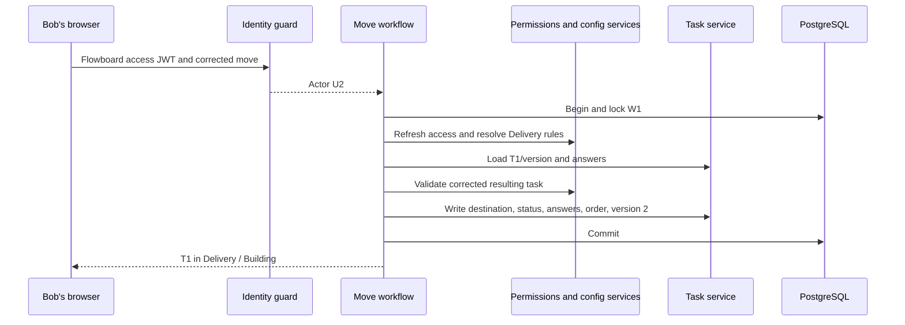

# One story through all of Flowboard

Status: planned example, not a claim of implemented behavior. Navigation: [hub](README.md), [complete ER](er-diagram.md), [glossary](glossary.md).

This story covers all 16 business tables. Short labels such as U2/T1 are reading aids; real stored IDs are UUIDs. Its private Delivery and required release_date are a separate example/test fixture, not changes to the default seed.

## 1. Bob signs in

WORKSPACES contains Flowboard W1. USERS contains Alice U1, Bob U2, Carol U3. WORKSPACE_MEMBERSHIPS makes Alice admin and Bob/Carol members. Bob's USER_CREDENTIALS row has user_id=U2 and a password hash. His local AUTH_IDENTITIES row maps issuer urn:flowboard:local and subject U2 to user U2.

The local verifier checks Bob's password, resolves that local identity, and passes `{ userId: U2, authIdentityId: I2 }` to the shared session service. After active-membership checks it inserts AUTH_SESSIONS S1 and REFRESH_TOKENS R1's hash. Bob receives a short access JWT and HttpOnly refresh cookie.

The database prevents S1 from claiming Bob while pointing to Alice's identity. If Bob later uses SSO, a new pre-linked identity can point to U2 without needing a local password or changing his business records.

## 2. Alice sets up a place to work

CONTAINERS contains Engineering -> Q2 Launch -> Backlog/Delivery. In this example Delivery is private. CONTAINER_GRANTS allows Bob on Delivery. His public ancestors and explicit allow make the path accessible. If an ancestor denied Bob, the child allow would not bypass it.

Engineering owns one STATUS_SETS row; its STATUSES are todo/in_progress/done. Delivery owns another set with todo/building/review/done. Backlog inherits Engineering. Delivery replaces it.

CUSTOM_FIELD_DEFINITIONS and CUSTOM_FIELD_OPTIONS establish:

| Owner       | Definition                        | Example option/value               |
| ----------- | --------------------------------- | ---------------------------------- |
| Engineering | effort, required number           | 3                                  |
| Q2 Launch   | work_type, required single_select | Bug option O1 or Feature option O2 |
| Q2 Launch   | tags, optional multi_select       | Customer reported O3, Urgent O4    |
| Backlog     | customer_note, optional text      | Customer report description        |
| Delivery    | release_date, required date       | 2026-10-30                         |
| Delivery    | verified, optional checkbox       | false                              |

The field key identifies the question; option IDs identify choices. Labels may change without changing those references.

## 3. Bob creates Fix login

TASKS T1 belongs to Backlog with status in_progress, priority high, creator U2, version 1. TASK_ASSIGNEES links T1 to Bob. TASK_FIELD_VALUES supplies Effort=3, work_type=O1, tags=[O3], and a customer note.

The task workflow checks Backlog access, valid status, active assignee, required values, option ownership, and title/due-date rules. It creates all rows atomically. The board shows T1 in In Progress; the table shows the same task as a row. No board/card/table ownership records are created.

## 4. Bob moves it to Delivery

An uncorrected move fails: in_progress does not exist in Delivery, release_date is missing, and Backlog-only customer_note would be out of scope. The workflow keeps T1 and all values/positions unchanged.

Bob chooses building, supplies release_date, explicitly clears customer_note, and sets verified=false. The workflow locks W1, refreshes membership/access for both lists, resolves destination config, validates version/answers/anchor, and commits task/list/status/placement/version and answer changes together. T1 remains the same task; Bob remains assigned; shared effort/type/tags remain; version becomes 2.

## 5. Access renews and a future provider can join

Refresh consumes R1 and creates R2 under S1. Replaying consumed R1 commits S1.revoked_at, so all S1 refresh tokens and access JWTs stop working. There is no token-level revoked_at column. A normal logout affects S1, not Bob's other device sessions.

Later, a verified provider identity maps to U2 and converges before the same Flowboard session/token service. It creates a new session with that external auth_identity_id. Permissions still read WORKSPACE_MEMBERSHIPS and CONTAINER_GRANTS; T1 and its user/value links do not change. Provider tokens never become business API credentials.

| Part of the story   | Tables touched                                                              |
| ------------------- | --------------------------------------------------------------------------- |
| Identity/login      | USERS, AUTH_IDENTITIES, USER_CREDENTIALS, WORKSPACE_MEMBERSHIPS, WORKSPACES |
| Login lifetime      | AUTH_SESSIONS, REFRESH_TOKENS                                               |
| Organization/access | CONTAINERS, CONTAINER_GRANTS                                                |
| Configuration       | STATUS_SETS, STATUSES, CUSTOM_FIELD_DEFINITIONS, CUSTOM_FIELD_OPTIONS       |
| Actual work         | TASKS, TASK_ASSIGNEES, TASK_FIELD_VALUES                                    |
