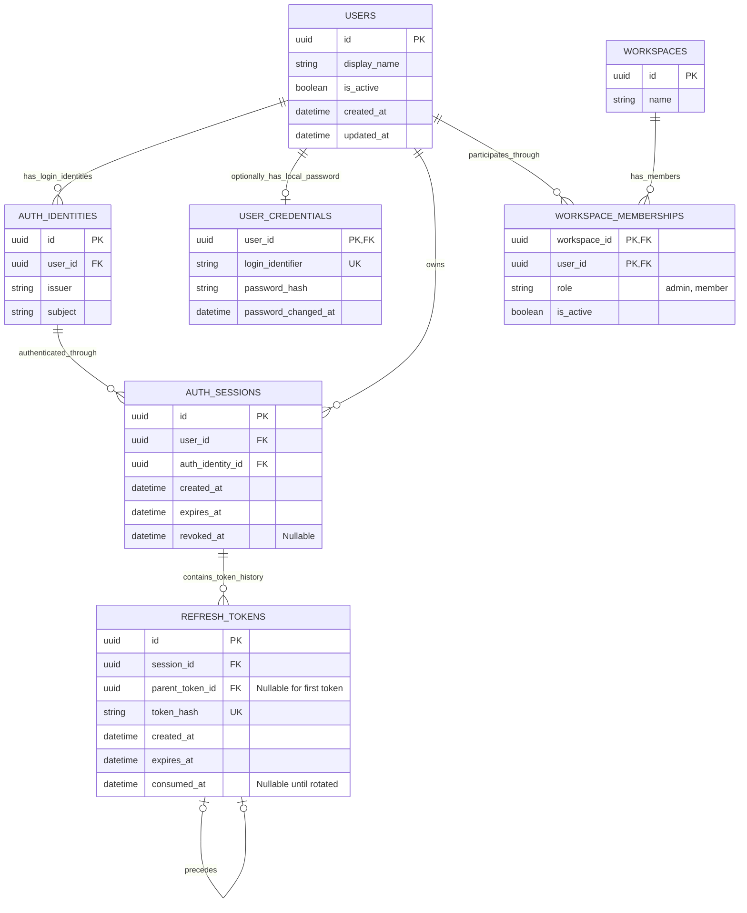
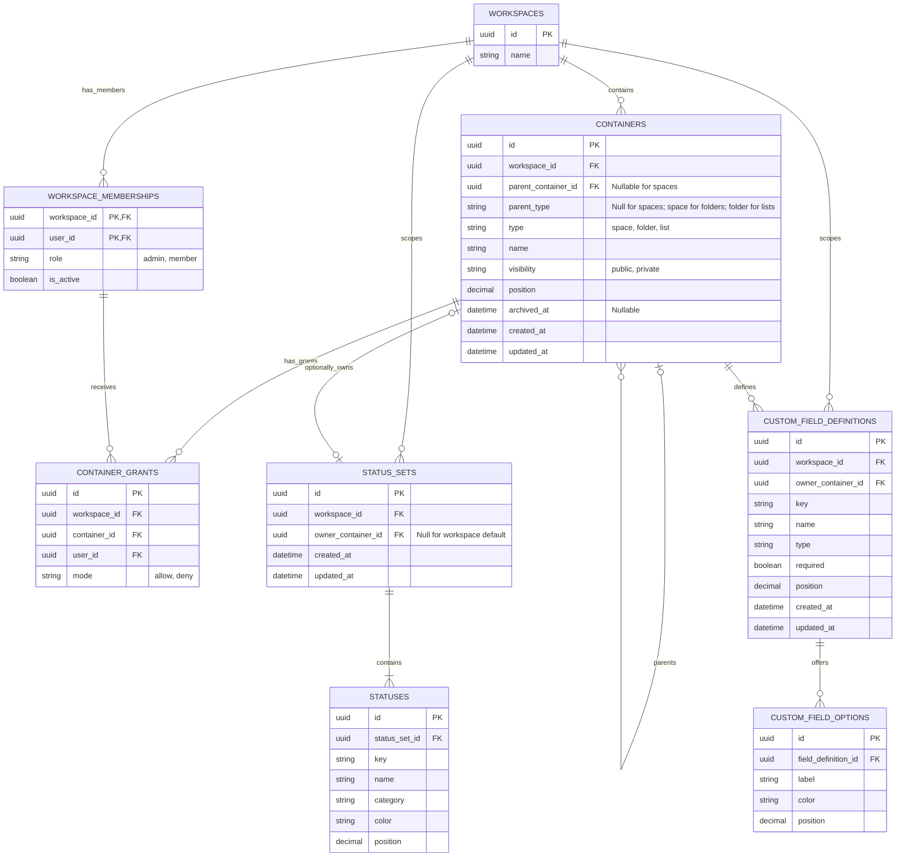
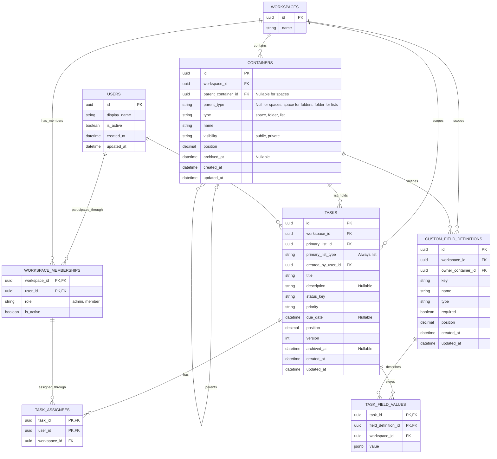

# Complete Flowboard ER reference

Generated from the owned schema blocks in the module guides. Do not edit columns here independently.

Status: schema reference for the implemented Day 1 foundation and planned later phases. [Hub](README.md) | [Architecture](architecture.md) | [Business example](business-walkthrough.md)

Refresh with `python3 docs/tools/check_docs.py --write`; check with `python3 docs/tools/check_docs.py --check`.

The three views describe the same 16 tables; repeated boxes are the same entities. PK means primary key, FK foreign key, and UK unique key. A one-to-many line means one parent can have many child rows. Optional relationships can have no child or no referenced parent as labeled. Shared configuration validity is also checked by application workflows, not only foreign keys.

## 1. Identity, credentials, sessions, and membership

## 2. Hierarchy, permissions, and configuration

## 3. Tasks, assignments, and custom values

## Table owners

| Table                    | Single owning guide                       |
| ------------------------ | ----------------------------------------- |
| USERS                    | [identity](modules/identity.md)           |
| AUTH_IDENTITIES          | [identity](modules/identity.md)           |
| USER_CREDENTIALS         | [identity](modules/identity.md)           |
| WORKSPACE_MEMBERSHIPS    | [identity](modules/identity.md)           |
| AUTH_SESSIONS            | [identity](modules/identity.md)           |
| REFRESH_TOKENS           | [identity](modules/identity.md)           |
| WORKSPACES               | [hierarchy](modules/hierarchy.md)         |
| CONTAINERS               | [hierarchy](modules/hierarchy.md)         |
| CONTAINER_GRANTS         | [permissions](modules/permissions.md)     |
| STATUS_SETS              | [statuses](modules/statuses.md)           |
| STATUSES                 | [statuses](modules/statuses.md)           |
| CUSTOM_FIELD_DEFINITIONS | [custom-fields](modules/custom-fields.md) |
| CUSTOM_FIELD_OPTIONS     | [custom-fields](modules/custom-fields.md) |
| TASKS                    | [tasks](modules/tasks.md)                 |
| TASK_ASSIGNEES           | [tasks](modules/tasks.md)                 |
| TASK_FIELD_VALUES        | [tasks](modules/tasks.md)                 |

## Business rules that are not simple foreign keys

| Rule                                                                                              | Owner                                                                   |
| ------------------------------------------------------------------------------------------------- | ----------------------------------------------------------------------- |
| A task's container must be a list and its ancestry active.                                        | [Hierarchy](modules/hierarchy.md) and [workflows](modules/workflows.md) |
| Task status_key must belong to its list's resolved set; there is no direct global status FK.      | [Statuses](modules/statuses.md)                                         |
| JSONB answers must match effective types, required rules, and option IDs.                         | [Custom fields](modules/custom-fields.md)                               |
| A session's user and authenticating identity must match; credentials belong directly to the user. | [Identity](modules/identity.md)                                         |
| Session revoked_at is the refresh-family revocation source; token rows have no revoked_at.        | [Identity](modules/identity.md)                                         |
| Moves and config edits validate every affected retained record before a single commit.            | [Workflows](modules/workflows.md)                                       |

Migration history and seed-version bookkeeping are infrastructure metadata, not extra business tables.
