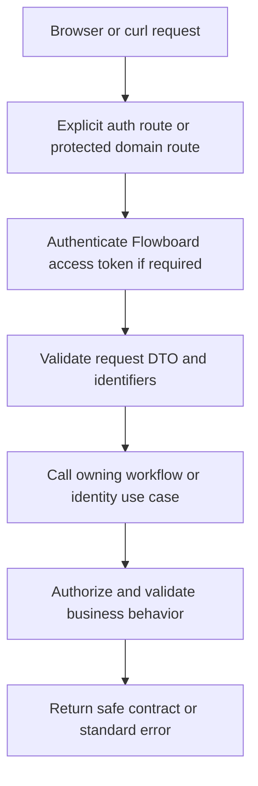

# Module: API and contracts

Status: Day 2 task/read routes and Day 3 admin routes added. Swagger route metadata and the second-channel curl cookbook remain deferred by user direction; runtime verification pending. Code owners: `libs/shared/contracts` and NestJS HTTP adapters. Navigation: [hub](../README.md), [ADR-0005](../adr/0005-delivery-and-consistency.md), [workflows](workflows.md).

## 1. Purpose and example

The API is the common language used by the React website and a lightweight curl cookbook. A future thin CLI can call those same routes. Both channels must get the same permission checks, validation, and errors. This guide owns route names and common HTTP shapes so individual screens cannot invent a second API.

For example, moving Fix login sends a destination list, desired corrections, and the task version. The server resolves the task's actual source and all business rules. A request cannot declare itself admin or supply an Actor.

## 2. Ownership, data, and decisions

This module owns transport contracts and standardization, not a database table. The [ER reference](../er-diagram.md) describes stored entities; API DTOs are intentional projections, not raw Prisma objects.

| Convention     | Contract                                                                                                                   |
| -------------- | -------------------------------------------------------------------------------------------------------------------------- |
| Version/style  | Resource-oriented REST under `/v1`; Swagger matches running code.                                                          |
| Authentication | Flowboard Bearer access JWT except explicit auth/health/docs routes; no mock header identity.                              |
| Input          | Validate/whitelist DTO fields; reject unknown/protected fields. Never trust supplied roles/permissions/user context.       |
| IDs/times      | Real UUID strings and ISO datetimes in JSON; examples such as T1/U2 in prose are human labels. Field dates use YYYY-MM-DD. |
| Collections    | `{ items, page: { offset, limit, total, hasMore } }`, default offset 0, limit 50, max 100.                                 |
| Ordering       | Stable tie-breakers; placement is server-owned. Task due-date nulls last; priority urgent/high/normal/low/none.            |
| Updates        | PATCH absent key preserves; nullable optional values clear. Task mutations require expectedVersion except creation.        |
| Errors         | One `{ error: { code, message, details? } }` envelope; details contain path/reason entries when appropriate.               |

```json
{
  "error": {
    "code": "CUSTOM_FIELD_INVALID",
    "message": "Effort must be a number.",
    "details": [{ "path": "customFields.effort", "reason": "Expected number" }]
  }
}
```

| HTTP status | Meaning                                                                                    |
| ----------- | ------------------------------------------------------------------------------------------ |
| 400         | Invalid DTO, parent type, status, field value, selection, or placement anchor.             |
| 401         | Missing/invalid/expired token or unusable session/refresh.                                 |
| 403         | Inactive membership, forbidden resource/admin action, or rejected cookie-sensitive Origin. |
| 404         | Resource absent or unavailable through archived ancestry.                                  |
| 409         | Stale task version or configuration change that would break retained data.                 |
| 429 / 503   | Login throttled / dependency unavailable.                                                  |

Successful creation returns 201; reads and state-returning updates return 200; archive/delete/reset/logout actions without a body return 204. Do not return 200 with an error embedded in the payload.

## 3. Connections and interfaces

### Route catalog

| Routes                                                                              | Owner/use case                                                                                                                                                                                                                                                            |
| ----------------------------------------------------------------------------------- | ------------------------------------------------------------------------------------------------------------------------------------------------------------------------------------------------------------------------------------------------------------------------- |
| POST `/v1/auth/login`, `/v1/auth/refresh`, `/v1/auth/logout`, `/v1/auth/logout-all` | Identity verifies/renews/revokes with the cookie and Origin rules in its guide.                                                                                                                                                                                           |
| GET `/v1/me`, `/v1/users`                                                           | Identity's safe current-user/member projections; collection pagination for users. `/v1/me` adds `displayName` and nullable `email` to the actor IDs/role.                                                                                                                 |
| GET `/v1/tree`                                                                      | Tree workflow returns one bounded, permission-filtered active hierarchy snapshot.                                                                                                                                                                                         |
| GET `/v1/workspaces/:id/overview`                                                   | Current workspace only: one permission-filtered read snapshot of active visible task/list counts, seven-day due-soon count, and five nearest future-due tasks. No pagination because only five upcoming tasks are returned; list rows cover every accessible active list. |
| GET/PATCH `/v1/workspaces/:id`                                                      | Read/rename the single root; admin required to rename; no second-workspace creation endpoint.                                                                                                                                                                             |
| GET/POST `/v1/containers`, GET/PATCH/DELETE `/v1/containers/:id`                    | Filtered container collection; active-member create under an accessible parent; authorized read and admin-only rename/visibility/archive. Creation includes logical parentId and type.                                                                                    |
| POST `/v1/containers/reorder`                                                       | Admin supplies parentId and complete ordered sibling IDs; cannot change parents.                                                                                                                                                                                          |
| GET/POST `/v1/lists/:id/tasks`                                                      | Paginated/sorted task list and task create.                                                                                                                                                                                                                               |
| GET/PATCH/DELETE `/v1/tasks/:id`                                                    | Task detail/update/archive; archive supplies expectedVersion query parameter.                                                                                                                                                                                             |
| POST `/v1/tasks/:id/placement`                                                      | Change status/placement inside stored list, with expectedVersion and optional beforeTaskId.                                                                                                                                                                               |
| POST `/v1/tasks/:id/move`                                                           | Atomic cross-list move with destinationListId, corrections, expectedVersion, optional beforeTaskId.                                                                                                                                                                       |
| GET `/v1/lists/:id/board`                                                           | Complete resolved configuration plus paginated task projection.                                                                                                                                                                                                           |
| GET `/v1/lists/:id/resolved-statuses`, `/v1/lists/:id/resolved-fields`              | Authorized effective configuration, order, and source ownership.                                                                                                                                                                                                          |
| GET/PUT/DELETE `/v1/containers/:id/status-set`                                      | Read local set/inherited preview, replace full local set, or reset to inheritance. PUT covers status add/edit/remove/reorder atomically.                                                                                                                                  |
| GET/PUT `/v1/workspaces/:id/status-set`                                             | Read/edit workspace default; no deletion of the required fallback.                                                                                                                                                                                                        |
| GET/POST `/v1/containers/:id/fields`, PATCH/DELETE `/v1/fields/:id`                 | Local definition collection/create/edit/remove; option edits are nested in the field candidate.                                                                                                                                                                           |
| POST `/v1/containers/:id/fields/reorder`                                            | Reorder that owner's definitions, not inherited definitions.                                                                                                                                                                                                              |
| GET `/v1/containers/:id/grants`, PUT/DELETE `/v1/containers/:id/grants/:userId`     | Admin or accessible exact-container creator reads rules, upserts allow/deny, or removes an explicit rule.                                                                                                                                                                 |

Container creation is available to active members: a space uses null parentId, while folder/list creation requires an accessible, active parent of the required type. New container responses and filtered reads include `createdByUserId` (null for older containers without trusted creator history). A private member-created container receives a creator allow grant atomically. Admin-only container rename, visibility change, archive, reorder, and config mutations use workflows. Grant reads/writes allow an admin or the accessible container's recorded creator; other members get 403. A creator cannot edit their own grant, and creator allow requires the target member to access the parent path (400 otherwise). Removing unused definitions/options/grants/assignment/value rows is intentional; never cascade-delete task history. A nonexistent local set reads as local=null with inherited preview. Resetting a local set is subject to retained-task safety checks. Per-owner definition collections are paginated; resolved schema/set payloads are complete configuration snapshots. `/v1/users` includes each active member's role; grant PUT accepts active members only and returns 400 for an admin target because admins bypass grants.

Day 3 admin request shapes: container create accepts `{ parentId, type, name, visibility? }`; a reorder accepts `{ parentId, ids }` with every active sibling exactly once. Status PUT accepts an ordered `{ statuses: [{ key, name, category, color }] }` complete set. Field create/PATCH accepts `{ key, name, type, required, options }`, with ordered options `{ id?, label, color }`; an existing field key is immutable, and an existing option ID must belong to that field. Grant PUT accepts `{ mode: "allow" | "deny" }`. A status-set GET returns `local` and `inherited`; `local: null` means the selected owner has no override.

Shared contracts declare request/response types, enums, pagination/error/Actor-related common types without runtime provider or ORM dependencies. Controllers parse route UUIDs; workflows whitelist Day 3 JSON candidates and call the owner validators. Complete typed DTO and Swagger metadata remain follow-up work. The web imports contracts and calls HTTP, never backend functions.

### Secondary client boundary

The task, board, and admin routes work with any HTTP client. A client signs in through `/v1/auth/login`, sends the Flowboard access token as a Bearer token, and uses the same `/v1` resources as the web UI. The curl cookbook and browser/curl parity check are still pending, so the assignment's second-channel requirement is not complete. A future CLI would also use HTTP; it must not import NestJS or domain repositories, bypass workflows, or add CLI-specific business endpoints.

For refresh and logout, a non-browser client can retain the issued refresh cookie in a cookie jar and send the configured allowed Origin on cookie-sensitive auth requests, following the existing identity contract. It receives the same status codes and error envelope as the browser. This is a client transport detail, not a separate credential or session model. The shared contracts and Swagger examples should describe the HTTP exchange without assuming React component state.

### Future webhook boundary

A webhook can be another integration channel, but it is not automatically another `/v1` user client. An incoming webhook would need its own versioned payload contract and sender verification at the HTTP edge. The adapter would resolve an authorized internal principal and translate the request into an existing workflow; it must not create tasks through a repository or trust a claimed user/role in the payload. Whether the sender acts as a user or a distinct integration identity needs an explicit identity and permission design before any endpoint is added.

An outgoing webhook would publish a separate, versioned event contract after a domain change commits. It needs delivery, signature, retry, and failure semantics before implementation; it must not expose private task data merely because an event occurred. Neither webhook direction is scheduled for Days 2-4. The shared REST types remain for web/curl/future CLI; webhook payloads will share stable domain identifiers and semantics where appropriate, not UI state or REST response envelopes.

UI-only state includes the selected tree node, board/table toggle, open drawer, drag preview, form draft, and pending indicators. Access decisions, effective statuses/fields, task validation, versions, and writes remain server-side so every authorized channel observes the same result.

The overview is a reusable read contract for web, curl, and a future CLI. Its `totals` include `visibleTasks`, `accessibleLists`, and `dueSoon`; `dueSoonWindow` gives the UTC start and exclusive end used for the count. `lists` carry each visible list's path and active task count. `upcoming` carries task ID, title, list ID, and due datetime only. It excludes archived tasks, inaccessible lists, and overdue tasks. The server orders upcoming items by due datetime and task ID; it never exposes private-list counts through aggregate totals. UI navigation and the chosen default screen stay with the web client.

## 4. Workflows and sequence diagrams

### HTTP boundary



```mermaid
sequenceDiagram
    participant Client as React or curl
    participant HTTP as Controller / guard / DTO
    participant Flow as Workflow
    participant Owners as Domain services
    Client->>HTTP: Same versioned JSON request and token
    HTTP->>HTTP: Establish Actor; validate shape
    HTTP->>Flow: Trusted context plus validated input
    Flow->>Owners: Business checks and owned operations
    Owners-->>Flow: Projection or typed failure
    Flow-->>HTTP: Result
    HTTP-->>Client: Standard response/error
```

Move request example (UUID placeholders must be replaced with IDs returned by the API):

```json
{
  "destinationListId": "<delivery-list-uuid>",
  "statusKey": "building",
  "customFields": {
    "customer_note": null,
    "release_date": "2026-10-30",
    "verified": false
  },
  "expectedVersion": 1
}
```

When statusKey is omitted on move, retain the current key only if valid in destination. An omitted beforeTaskId appends to the destination group. Task create requires title and statusKey; server assigns creator/list scope/version/position/timestamps. Config PUT/PATCH checks a candidate against current data inside the lock. Config records have no version field in this schema, so later valid admin edits can overwrite earlier cosmetic edits; richer config conflict handling is future scope.

When scheduled, the cookbook will demonstrate login with an allowed Origin and cookie jar, capture/use of access JWT, tree/board lookup, task edit, refresh, and logout. Examples must run against actual routes and never rely on X-User-Id. The existing Swagger shell is not complete route/schema documentation yet; it needs request/response DTO metadata and a route/security parity check.

## 5. Build phases, failure cases, and change guide

Define shared types/error conventions in Day 1, domain routes/Swagger with workflows in Days 2-3, and verify browser/cookbook parity in Day 4. UI-only behavior includes drawer state, selection, and pending indicators; permission, inheritance, and validation behavior remains shared on the server.

| ID     | Test TODO: setup/action -> expected result                                                                                                                 |
| ------ | ---------------------------------------------------------------------------------------------------------------------------------------------------------- |
| API-01 | Browser and cookbook perform the same login, read, and task edit -> same auth, permission, validation, and response behavior; no web-only domain endpoint. |
| API-02 | Invalid DTO, UUID, unknown/protected field -> standard 400 without trusting body role/user.                                                                |
| API-03 | All error classes -> correct status and single envelope.                                                                                                   |
| API-04 | Collection pagination/default/max/ties -> stable documented shape and ordering.                                                                            |
| API-05 | Task expectedVersion omitted/stale -> 400/409; no partial update.                                                                                          |
| API-06 | Swagger/runtime route/security mismatch -> fail final verification.                                                                                        |
| API-07 | Public health/docs -> no domain secrets/data; domain route without JWT -> 401.                                                                             |
| API-08 | Local vs inherited config and reset endpoints -> correct complete snapshots and safety policy.                                                             |
| API-09 | Overview requested as another workspace or by a member with private lists -> 404 or correctly filtered counts/items; same contract usable by curl.         |
| API-10 | Admin config/grant routes with malformed or foreign IDs -> 400/404 and no raw Prisma failure or partial write.                                             |
| API-11 | Rejected status/field candidate -> 409 on retained task conflict, 400 on malformed candidate; standard error envelope.                                     |
| API-12 | Creator reads/changes own grants through the same route as admin; unrelated member gets 403 and inaccessible-parent share gets 400.                        |

When changing an endpoint, update this route catalog, owner guide, shared DTOs, Swagger, web caller/cookbook, and acceptance cases in the same change. Keep endpoint changes out of repository implementation details.
