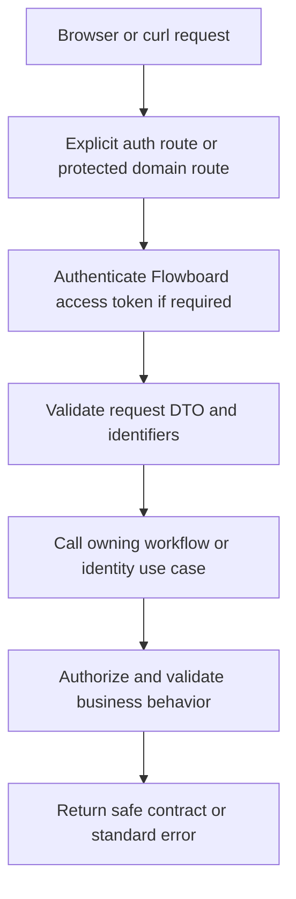

# Module: API and contracts

Status: planned. Code owners: `libs/shared/contracts` and NestJS HTTP adapters. Navigation: [hub](../README.md), [ADR-0005](../adr/0005-delivery-and-consistency.md), [workflows](workflows.md).

## 1. Purpose and example

The API is the common language used by the React website and the curl cookbook. Both channels must get the same permission checks, validation, and errors. This guide owns route names and common HTTP shapes so individual screens cannot invent a second API.

For example, moving Fix login sends a destination list, desired corrections, and the task version. The server resolves the task's actual source and all business rules. A request cannot declare itself admin or supply an Actor.

## 2. Ownership, data, and decisions

This module owns transport contracts and standardization, not a database table. The [ER reference](../er-diagram.md) describes stored entities; API DTOs are intentional projections, not raw Prisma objects.

| Convention | Contract |
| --- | --- |
| Version/style | Resource-oriented REST under `/v1`; Swagger matches running code. |
| Authentication | Flowboard Bearer access JWT except explicit auth/health/docs routes; no mock header identity. |
| Input | Validate/whitelist DTO fields; reject unknown/protected fields. Never trust supplied roles/permissions/user context. |
| IDs/times | Real UUID strings and ISO datetimes in JSON; examples such as T1/U2 in prose are human labels. Field dates use YYYY-MM-DD. |
| Collections | `{ items, page: { offset, limit, total, hasMore } }`, default offset 0, limit 50, max 100. |
| Ordering | Stable tie-breakers; placement is server-owned. Task due-date nulls last; priority urgent/high/normal/low/none. |
| Updates | PATCH absent key preserves; nullable optional values clear. Task mutations require expectedVersion except creation. |
| Errors | One `{ error: { code, message, details? } }` envelope; details contain path/reason entries when appropriate. |

```json
{
  "error": {
    "code": "CUSTOM_FIELD_INVALID",
    "message": "Effort must be a number.",
    "details": [{ "path": "customFields.effort", "reason": "Expected number" }]
  }
}
```

| HTTP status | Meaning |
| --- | --- |
| 400 | Invalid DTO, parent type, status, field value, selection, or placement anchor. |
| 401 | Missing/invalid/expired token or unusable session/refresh. |
| 403 | Inactive membership, forbidden resource/admin action, or rejected cookie-sensitive Origin. |
| 404 | Resource absent or unavailable through archived ancestry. |
| 409 | Stale task version or configuration change that would break retained data. |
| 429 / 503 | Login throttled / dependency unavailable. |

Successful creation returns 201; reads and state-returning updates return 200; archive/delete/reset/logout actions without a body return 204. Do not return 200 with an error embedded in the payload.

## 3. Connections and interfaces

### Route catalog

| Routes | Owner/use case |
| --- | --- |
| POST `/v1/auth/login`, `/v1/auth/refresh`, `/v1/auth/logout`, `/v1/auth/logout-all` | Identity verifies/renews/revokes with the cookie and Origin rules in its guide. |
| GET `/v1/me`, `/v1/users` | Identity's safe current-user/member projections; collection pagination for users. |
| GET `/v1/tree` | Tree workflow returns one bounded, permission-filtered active hierarchy snapshot. |
| GET/PATCH `/v1/workspaces/:id` | Read/rename the single root; admin required to rename; no second-workspace creation endpoint. |
| GET/POST `/v1/containers`, GET/PATCH/DELETE `/v1/containers/:id` | Filtered container collection/create and authorized read/rename/visibility/archive workflows. Creation includes logical parentId and type. |
| POST `/v1/containers/reorder` | Admin supplies parentId and complete ordered sibling IDs; cannot change parents. |
| GET/POST `/v1/lists/:id/tasks` | Paginated/sorted task list and task create. |
| GET/PATCH/DELETE `/v1/tasks/:id` | Task detail/update/archive; archive supplies expectedVersion query parameter. |
| POST `/v1/tasks/:id/placement` | Change status/placement inside stored list, with expectedVersion and optional beforeTaskId. |
| POST `/v1/tasks/:id/move` | Atomic cross-list move with destinationListId, corrections, expectedVersion, optional beforeTaskId. |
| GET `/v1/lists/:id/board` | Complete resolved configuration plus paginated task projection. |
| GET `/v1/lists/:id/resolved-statuses`, `/v1/lists/:id/resolved-fields` | Authorized effective configuration, order, and source ownership. |
| GET/PUT/DELETE `/v1/containers/:id/status-set` | Read local set/inherited preview, replace full local set, or reset to inheritance. PUT covers status add/edit/remove/reorder atomically. |
| GET/PUT `/v1/workspaces/:id/status-set` | Read/edit workspace default; no deletion of the required fallback. |
| GET/POST `/v1/containers/:id/fields`, PATCH/DELETE `/v1/fields/:id` | Local definition collection/create/edit/remove; option edits are nested in the field candidate. |
| POST `/v1/containers/:id/fields/reorder` | Reorder that owner's definitions, not inherited definitions. |
| GET `/v1/containers/:id/grants`, PUT/DELETE `/v1/containers/:id/grants/:userId` | Admin reads rules, upserts allow/deny, or removes an explicit rule. |

Config/grant/container mutations are admin-only and use workflows. Removing unused definitions/options/grants/assignment/value rows is intentional; never cascade-delete task history. A nonexistent local set reads as local=null with inherited preview. Resetting a local set is subject to retained-task safety checks. Per-owner definition collections are paginated; resolved schema/set payloads are complete configuration snapshots.

Shared contracts declare request/response types, enums, pagination/error/Actor-related common types without runtime provider or ORM dependencies. Nest DTOs implement transport validation; dynamic schema validation remains in custom fields/statuses. The web imports contracts and calls HTTP, never backend functions.

## 4. Workflows and sequence diagrams

### HTTP boundary



```mermaid
sequenceDiagram
    participant Client as React or curl
    participant HTTP as Controller / guard / DTO
    participant Flow as Workflow
    participant Owners as Domain services
    Client->>HTTP: Same versioned JSON request and token
    HTTP->>HTTP: Establish Actor; validate shape
    HTTP->>Flow: Trusted context plus validated input
    Flow->>Owners: Business checks and owned operations
    Owners-->>Flow: Projection or typed failure
    Flow-->>HTTP: Result
    HTTP-->>Client: Standard response/error
```

Move request example (UUID placeholders must be replaced with IDs returned by the API):

```json
{
  "destinationListId": "<delivery-list-uuid>",
  "statusKey": "building",
  "customFields": {
    "customer_note": null,
    "release_date": "2026-10-30",
    "verified": false
  },
  "expectedVersion": 1
}
```

When statusKey is omitted on move, retain the current key only if valid in destination. An omitted beforeTaskId appends to the destination group. Task create requires title and statusKey; server assigns creator/list scope/version/position/timestamps. Config PUT/PATCH checks a candidate against current data inside the lock. Config records have no version field in this schema, so later valid admin edits can overwrite earlier cosmetic edits; richer config conflict handling is future scope.

The cookbook demonstrates login with an allowed Origin and cookie jar, capture/use of access JWT, tree/board lookup, task edit, refresh, and logout. Examples must run against actual routes and never rely on X-User-Id. Swagger documents auth/security and matches this route catalog when implemented.

## 5. Build phases, failure cases, and change guide

Define shared types/error conventions in Day 1, domain routes/Swagger with workflows in Days 2-3, and verify browser/cookbook parity in Day 4. UI-only behavior includes drawer state, selection, and pending indicators; permission, inheritance, and validation behavior remains shared on the server.

| ID | Test TODO: setup/action -> expected result |
| --- | --- |
| API-01 | Browser and cookbook perform same action -> same permission/validation behavior. |
| API-02 | Invalid DTO, UUID, unknown/protected field -> standard 400 without trusting body role/user. |
| API-03 | All error classes -> correct status and single envelope. |
| API-04 | Collection pagination/default/max/ties -> stable documented shape and ordering. |
| API-05 | Task expectedVersion omitted/stale -> 400/409; no partial update. |
| API-06 | Swagger/runtime route/security mismatch -> fail final verification. |
| API-07 | Public health/docs -> no domain secrets/data; domain route without JWT -> 401. |
| API-08 | Local vs inherited config and reset endpoints -> correct complete snapshots and safety policy. |

When changing an endpoint, update this route catalog, owner guide, shared DTOs, Swagger, web caller/cookbook, and acceptance cases in the same change. Keep endpoint changes out of repository implementation details.
