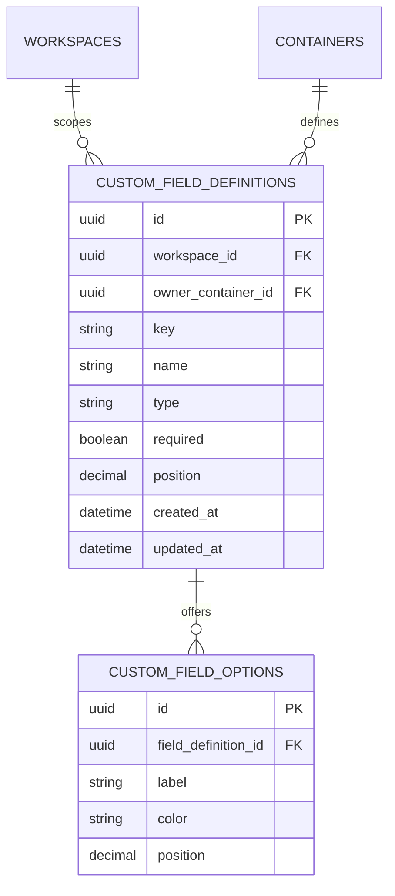
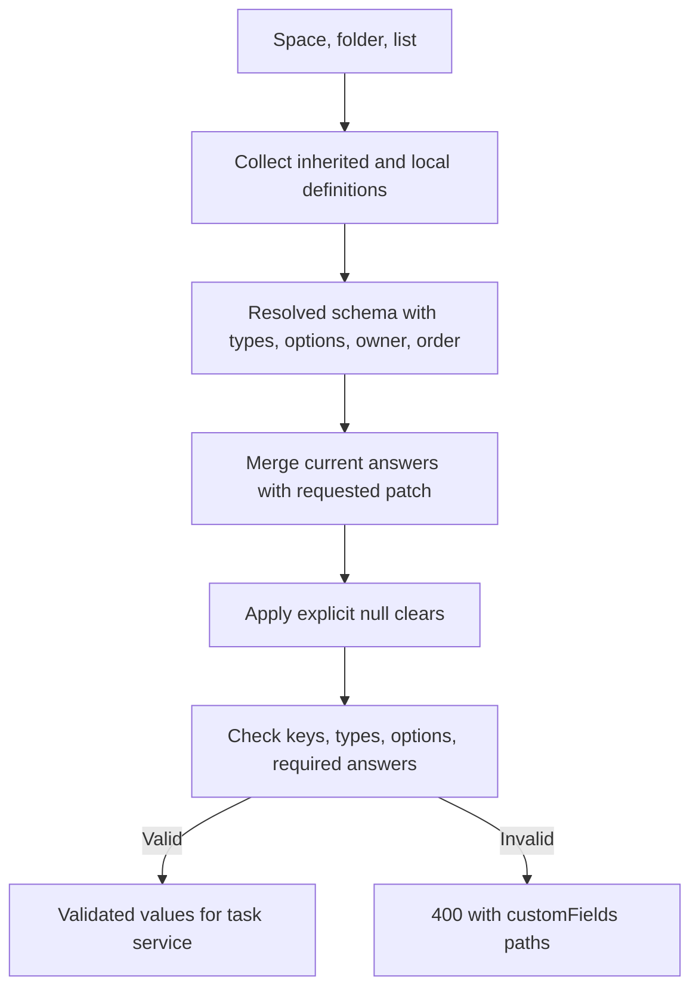

# Module: custom fields

Status: Day 2 resolution/answer validation and Day 3 local field/option writes, reorder, safety checks, and admin editor added; [manual Day 3 runtime review](../day3-runtime-review.md) completed, Day 4 executable tests pending. Code owner: `apps/api/src/custom-fields`. Navigation: [hub](../README.md), [ADR-0003](../adr/0003-scoped-configuration.md), [tasks](tasks.md), [workflows](workflows.md).

## 1. Purpose and example

Custom fields let a team add questions to a task without adding a new SQL column every time. A definition is the question; a value is one task's answer.

Engineering defines required numeric Effort. Q2 Launch adds a Work type select field. Backlog adds Customer note text. A Backlog task sees all three definitions and might answer Effort=3, Work type=Bug, Customer note="Customer reported". A Delivery-only Verified checkbox is not a Backlog field.

The schema is borrowed from ancestors, but answers belong to each task. Changing the display name Effort to Estimate does not change definition ID/key or rewrite task values.

## 2. Ownership, data, and decisions

Definitions/options belong here. TASK_FIELD_VALUES belongs to tasks; this module validates answers but does not own their persistence.

<!-- schema:start -->



<!-- schema:end -->

Definitions attach to space/folder/list, not workspace defaults. Resolve in that ancestor order, collecting definitions with no overrides. Keys are immutable and unique across the workspace, including sibling branches. This deliberately rejects duplicate semantic names/keys instead of introducing collision precedence. Display labels may repeat, but keys may not.

The owner reference uses `(owner_container_id, workspace_id)` so a definition cannot claim a container in another workspace. Task values pair their workspace with both task and definition IDs; effective ancestry and option validity remain workflow checks.

Order fields by owner level (space, folder, list), then configured position and stable ID. Inherited fields are edited at their owning container. The UI identifies that owner.

| Type          | Accepted answer                                | Required empty check                   |
| ------------- | ---------------------------------------------- | -------------------------------------- |
| text          | String                                         | Empty/whitespace-only text is missing. |
| number        | Finite JSON number; no numeric-string coercion | 0 is valid.                            |
| single_select | One option ID belonging to this definition     | Missing/null is missing.               |
| multi_select  | Array of distinct valid option IDs             | Empty array is missing.                |
| date          | Real calendar date in YYYY-MM-DD               | Missing/null is missing.               |
| checkbox      | Boolean                                        | false is valid.                        |

Select option labels/colors/order may change without changing option IDs. A required checkbox means an explicit boolean answer, not "must be checked." Future consent semantics would be a different rule.

| Mutation                           | Safety policy                                                                     |
| ---------------------------------- | --------------------------------------------------------------------------------- |
| Create/update values               | Validate the complete resulting task state against the resolved schema.           |
| Clear optional value               | API null removes its value row; missing patch key preserves existing value.       |
| Delete used field or option        | Block with 409, including usage by retained archived tasks.                       |
| Change type with any stored values | Block; do not coerce existing answers.                                            |
| Make required                      | Check every affected retained task has a valid nonempty answer before committing. |

An optional field may have no value row. Unknown keys and invalid options/types produce 400 with an exact customFields path. JSONB option IDs are validated in the workflow; they are not element-level SQL FKs.

## 3. Connections and interfaces

| Consumer        | Public capability                                                                                                 |
| --------------- | ----------------------------------------------------------------------------------------------------------------- |
| Hierarchy       | Ancestor/descendant scope used by schema resolution and impact checks.                                            |
| Task workflow   | Resolved definitions plus `validateResultingValues`; return validated values keyed by definition ID.              |
| Move workflow   | Destination schema, missing requirements, incompatible/source-only keys, and validation errors.                   |
| Config workflow | Candidate definition/options, affected schema results, safe-change checks; persistence only after usage approval. |
| Web             | Resolved input definitions/options/source owner and actionable error paths.                                       |

Validation itself is a pure rule operation once a schema and proposed resulting values are supplied. It must not read task tables. Task queries/value persistence go through the task service, coordinated by workflows. HTTP definition/value routes are in [API/contracts](api-contracts.md).

## 4. Workflows and sequence diagrams

### Resolve and validate answers



```mermaid
sequenceDiagram
    participant Web as Task drawer
    participant Flow as Update workflow
    participant F as Field resolver / validator
    participant T as Task service
    participant DB as Transaction coordinator
    Web->>Flow: Patch effort and expected task version
    Flow->>DB: Lock workspace; refresh membership and task access
    Flow->>T: Read stored task and values
    Flow->>F: Resolve schema; validate merged resulting answers
    alt Valid
        F-->>Flow: Validated definition-ID values
        Flow->>T: Write answers and increment version
        Flow->>DB: Commit
        Flow-->>Web: Updated task
    else Invalid
        F-->>Flow: Error paths
        Flow->>DB: Roll back
        Flow-->>Web: 400; existing answers unchanged
    end
```

### Make a field required or remove an option

```mermaid
sequenceDiagram
    participant Admin as Config UI
    participant Flow as Config workflow
    participant F as Field service
    participant H as Hierarchy
    participant T as Task queries
    participant DB as PostgreSQL
    Admin->>Flow: Candidate definition/options change
    Flow->>DB: Lock workspace; require current admin
    Flow->>F: Build candidate schema
    Flow->>H: Enumerate affected lists, including archived branches
    Flow->>T: Read retained usage/answers in affected scope
    Flow->>F: Validate every affected resulting task schema
    alt All stored answers remain valid
        Flow->>F: Persist definition/options change
        Flow->>DB: Commit
        Flow-->>Admin: Saved
    else In-use or missing required answer
        Flow->>DB: Roll back
        Flow-->>Admin: 409 with useful admin blocker information
    end
```

Adding a required definition to an existing scope is subject to the same safety check as making an existing field required. No automatic default backfill or answer stripping is included.

## 5. Build phases, failure cases, and change guide

Build definition/resolver/validator in Day 2, connect task forms/value writes immediately, and add admin field forms/safety checks in Day 3. Day 4 implements these cases.

| ID       | Test TODO: setup/action -> expected result                                                            |
| -------- | ----------------------------------------------------------------------------------------------------- |
| FIELD-01 | Definitions at space/folder/list -> additive schema with correct owner/order.                         |
| FIELD-02 | Duplicate workspace key or child override attempt -> reject.                                          |
| FIELD-03 | All six valid types -> accepted; 0/false remain meaningful values.                                    |
| FIELD-04 | String for number, invalid date, duplicate/foreign option -> 400 with field path.                     |
| FIELD-05 | Create missing required answer or clear required value -> 400.                                        |
| FIELD-06 | Patch omits a key -> preserve; null optional key -> remove row.                                       |
| FIELD-07 | Delete used field/option, including archived usage -> 409.                                            |
| FIELD-08 | Type change with stored answers -> 409; label/option label reorder -> preserves IDs/answers.          |
| FIELD-09 | New required definition or required=true with unsatisfied tasks -> 409 and no partial config change.  |
| FIELD-10 | Move lacks destination required answer or retains source-only answer -> explicit correction required. |
| FIELD-11 | Unused select option removal succeeds; used option in archived task blocks and preserves option set.  |
| FIELD-12 | Required field create/toggle with a missing archived answer -> 409 and no partial change.             |
| FIELD-13 | Duplicate workspace key or forged option ID -> reject without changing existing definitions.          |
| FIELD-14 | Drag local field order -> persisted order changes; inherited definitions keep their own owner/order.  |

For changes, update this guide, [ADR-0003](../adr/0003-scoped-configuration.md), task/move workflows, form rendering/error paths, seed answers, and test TODOs. A new field type requires validation and input rendering, not merely a new enum value.
