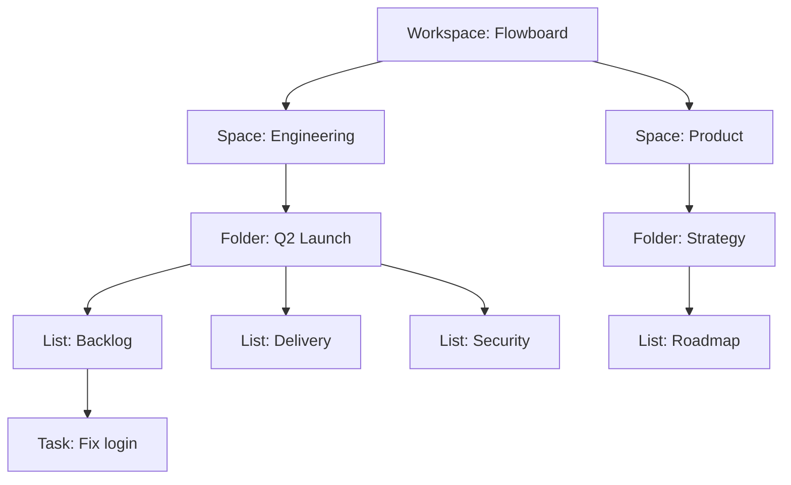
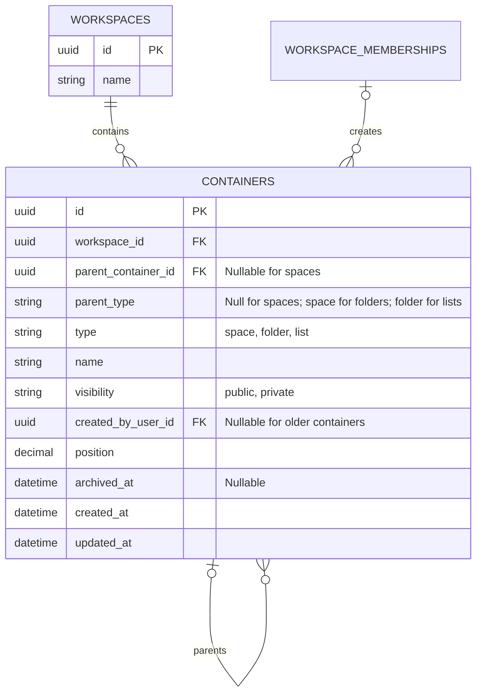
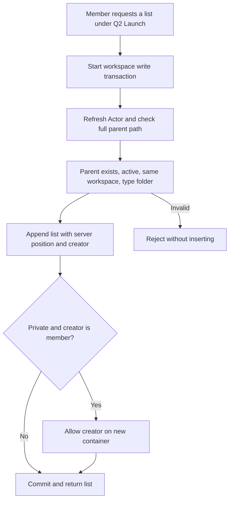
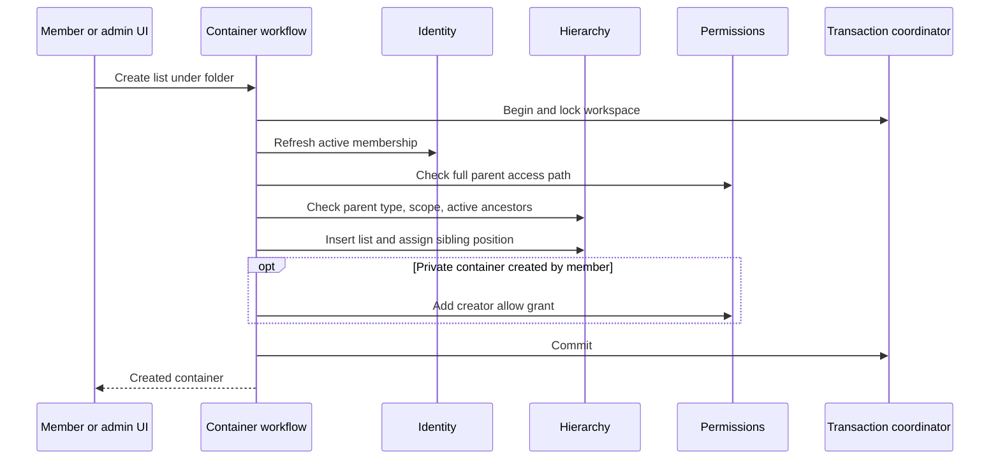

# Module: hierarchy

Status: Day 1–2 persistence/tree and Day 3 administration routes/UI added; runtime verification pending. Code owner: `apps/api/src/hierarchy`. Navigation: [hub](../README.md), [ADR-0002](../adr/0002-hierarchy-and-access.md), [complete ER](../er-diagram.md).

## 1. Purpose and example

Hierarchy is the filing cabinet for work. Flowboard is the workspace; Engineering is a space; Q2 Launch is a folder; Backlog is a list; Fix login is a task in Backlog. Each item has one parent. A parent can have many children.



Tasks belong only to lists. Status columns and table views are not extra ownership levels. A task's one path to the root determines its applicable configuration and access checks.

## 2. Ownership, data, and decisions

This module owns the workspace and container records. Tasks are shown in the example but their rows belong to the task module.

<!-- schema:start -->



<!-- schema:end -->

| Rule                  | Plain explanation                                                                                                                                   |
| --------------------- | --------------------------------------------------------------------------------------------------------------------------------------------------- |
| Workspace is separate | Spaces link through workspace_id and have no parent container. The API exposes the workspace as their parent.                                       |
| Strict parent types   | A folder needs a space; a list needs a folder. A row check fixes `parent_type` from its own type, and the parent FK matches the actual parent type. |
| Same workspace        | `(parent_container_id, workspace_id, parent_type)` references one container's `(id, workspace_id, type)`. No cross-workspace parent.                |
| Stable identity       | Renaming/reordering does not change IDs or ancestor config ownership.                                                                               |
| Archival              | Mark a container archived. Descendants become unavailable through ancestor checks; preserve their rows/config/values.                               |

Only one workspace is supported in the MVP. The root is seeded and may be renamed; creating a second tenant/workspace is outside scope. Space/folder/list CRUD is available through workflows. An empty folder or space is valid. Normal tree responses omit archived branches.

Every active workspace member may create a space under the workspace root, a folder under an accessible space, or a list under an accessible folder. Creation records the actor's user ID against their workspace membership. The creator of a private container receives a direct allow in the same transaction; an inaccessible or denied parent cannot be selected or used. A creator may share their own accessible container through direct grants, while an admin may grant access anywhere. Older containers with no recorded creator remain admin-managed. The shared creation form is available to members from the sidebar and to admins in Hierarchy. The current admin selection may suggest a parent, but it never hides the other creation options. Tasks are created in lists, not in folders. Only admins can rename, change visibility, archive, or reorder existing containers.

`parent_type` is an internal relation key, never a client input. Hierarchy-owned writes set it from the child type; the database check and FK reject a missing, forged, or mismatched value. This also prevents cycles because each non-root edge goes exactly one level toward a space. Existing invalid rows stop the migration for deliberate repair; no row is silently reparented. Physical parent deletion is restricted; archive retains the hierarchy.

Sibling order is scoped to one parent (spaces use the workspace as the sibling group). Reordering cannot change parentId. Use simple server-assigned dense positions in this small dataset; decimal storage permits whole-number positions. Recalculate the affected sibling group transactionally, with ID as a deterministic query tie-breaker.

## 3. Connections and interfaces

| Consumer        | Capability it needs                                                                          |
| --------------- | -------------------------------------------------------------------------------------------- |
| Permissions     | Ordered ancestor path with visibility and active/archive information.                        |
| Statuses/fields | Ancestor IDs and descendant lists affected by a configuration owner.                         |
| Workflows       | Validate container type/scope; create, rename, archive, reorder; load tree candidates.       |
| Tasks           | Its list FK targets this module's container table; tasks do not read hierarchy repositories. |
| Persistence     | Workspace row lock is acquired by the workflow/transaction coordinator.                      |

Expose read-only ancestry/descendant queries and transaction-aware owned writes. The public normal-read path rejects archived ancestors. A separate internal safety query can inspect retained archived branches when checking configuration usage. It does not become a public archive browsing API.

Permission filtering belongs to permissions/workflows. Hierarchy's active tree omits archived nodes and descendants with an archived ancestor; it cannot promise that a raw tree query is safe to return to a member. Creation checks fresh membership and the full parent path inside the workflow transaction. Other hierarchy writes require admin there.

## 4. Workflows and sequence diagrams

### Create a list





### Archive a folder

```mermaid
sequenceDiagram
    participant Web as Admin UI
    participant Flow as Archive workflow
    participant H as Hierarchy
    participant DB as PostgreSQL
    Web->>Flow: Archive Q2 Launch
    Flow->>DB: Lock workspace; refresh authorization
    Flow->>H: Mark Q2 Launch archived
    Flow->>DB: Commit
    Web->>Flow: Load Backlog or its tasks
    Flow->>H: Check ancestor activity
    H-->>Flow: Archived ancestor
    Flow-->>Web: 404 for unavailable archived resource
    Note over H,DB: Descendant rows remain stored; no physical cascade
```

Repeated archive can return the same archived result without duplicating effects. Restoring/reparenting archived branches is not an MVP operation.

## 5. Build phases, failure cases, and change guide

Build basic schema/ancestry in Day 1, consumption by resolvers/tasks in Day 2, and container administration/reorder UI in Day 3.

| ID      | Test TODO: setup/action -> expected result                                                                                    |
| ------- | ----------------------------------------------------------------------------------------------------------------------------- |
| HIER-01 | Create valid space/folder/list -> correct single parent and workspace.                                                        |
| HIER-02 | API or direct DB write with list under space, folder under folder, forged parent_type, or foreign-workspace parent -> reject. |
| HIER-03 | Renaming parent -> child IDs and references unchanged.                                                                        |
| HIER-04 | Reorder siblings -> stable persisted group order; cannot move parent.                                                         |
| HIER-05 | Archive folder -> tree/list/task normal access excludes all descendants, rows remain stored.                                  |
| HIER-06 | Safety query for retained archived data -> still finds configuration usage.                                                   |
| HIER-07 | Empty container -> valid response with no children.                                                                           |
| HIER-08 | Member creates under accessible parent -> success; rename/archive/reorder -> 403; second workspace unsupported.               |
| HIER-09 | Archive parent with descendant tasks/config -> active reads return 404 while retained safety queries still find them.         |
| HIER-10 | Reorder with omitted, duplicated, archived, or foreign sibling -> 400 and original positions remain.                          |
| HIER-11 | Admin and member can discover and create space/folder/list; parent picker offers valid, visible parents.                      |
| HIER-12 | Member creates private container -> creator ID and allow commit together, node visible; denied parent -> 403 and no write.    |
| HIER-13 | Existing container without a trusted creator -> admin manages sharing; creator cannot be inferred from an allow grant alone.  |

For a parent/type/archive change, update hierarchy, permissions, status/field ancestry callers, task/move examples, [ADR-0002](../adr/0002-hierarchy-and-access.md), and schema constraints. Never add nesting by only relaxing one UI control.
