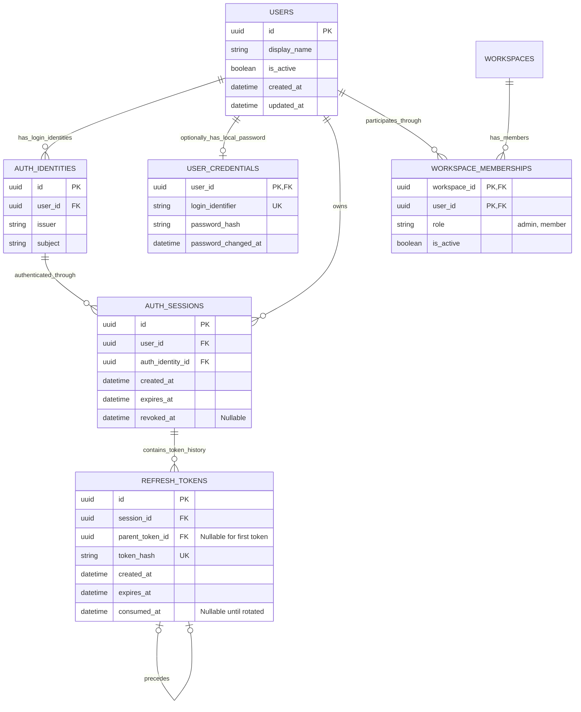
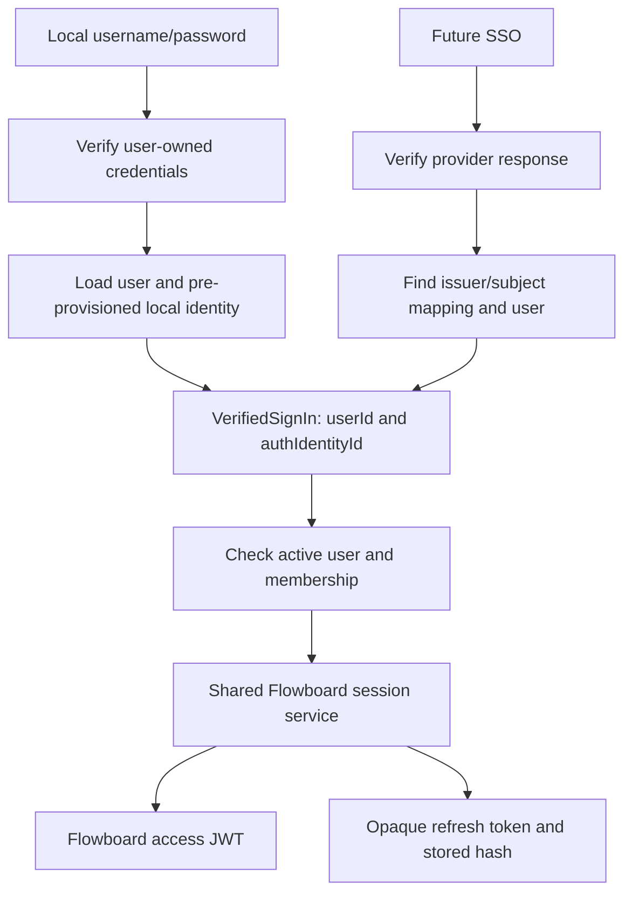
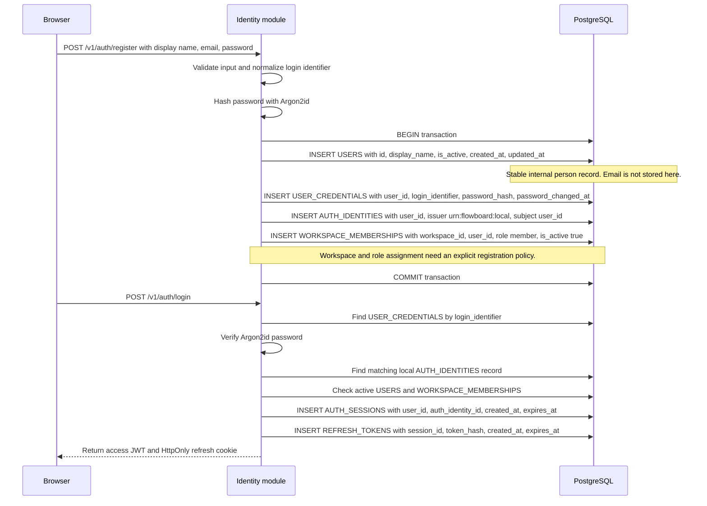

# Module: identity and authentication

Status: local-auth/session foundation implemented; future SSO remains planned, and executable test coverage is partial. Code owner: `apps/api/src/identity`. Navigation: [hub](../README.md), [ADR-0004](../adr/0004-authentication.md), [complete ER](../er-diagram.md), [test coverage](../test-plan.md).

## 1. Purpose and example

This module answers: "Who signed in, through which method, and is their login still usable?" Permissions answers a different question: "May that person open this list?"

Bob enters his local username/password. His password row belongs directly to his internal user. After verification, Flowboard finds Bob's local login identity, starts session S1, and issues a short-lived access token plus a refresh cookie. When SSO is added later, a verified provider identity can resolve to the same Bob and use exactly the same session/token service. His tasks, assignments, and grants keep their existing user ID.

This module owns users, membership, sign-in proofs, and login lifetime. It does not decide whether Bob may move a task or edit a status set.

## 2. Ownership, data, and decisions

| Table                 | Everyday meaning                                                     |
| --------------------- | -------------------------------------------------------------------- |
| USERS                 | The stable person inside Flowboard.                                  |
| AUTH_IDENTITIES       | Ways that person can prove identity: local now, a provider later.    |
| USER_CREDENTIALS      | Optional local username and password hash owned by that person.      |
| WORKSPACE_MEMBERSHIPS | The person's active membership and admin/member role in a workspace. |
| AUTH_SESSIONS         | One login, its authenticating identity, deadline, and revocation.    |
| REFRESH_TOKENS        | Secret hashes and predecessor history used to renew that login.      |

The following block is this module's owned schema. WORKSPACES is an external reference owned by hierarchy.

<!-- schema:start -->



<!-- schema:end -->

| Decision               | Rule and reason                                                                                                                                          |
| ---------------------- | -------------------------------------------------------------------------------------------------------------------------------------------------------- |
| User-owned credentials | USER_CREDENTIALS.user_id is PK/FK. No auth_identity_id column. A person may have no local password.                                                      |
| User audit timestamps  | USERS.created_at records provisioning; USERS.updated_at records the latest user-record change. They are not an event/audit-log substitute.               |
| Stable identity links  | Unique issuer/subject; never auto-link by email. Local issuer is `urn:flowboard:local`, subject is internal user UUID, with one local identity per user. |
| Consistent sessions    | Both session user_id and auth_identity_id are required. A composite FK ensures the identity belongs to that same user.                                   |
| One revocation source  | AUTH_SESSIONS.revoked_at invalidates its access tokens and entire refresh family. No REFRESH_TOKENS.revoked_at or session revocation-reason column.      |
| One rotation chain     | Parent and child tokens belong to the same session; a non-null parent has at most one child; parent link is immutable.                                   |

These are protected reference decisions, not optional implementation suggestions. Original images: [identity ER](../references/auth-identity-er.png), [token history](../references/session-token-er.png), [shared sign-in](../references/shared-sign-in-flow.png).

| Lifetime or storage | Default                                                                                                                           |
| ------------------- | --------------------------------------------------------------------------------------------------------------------------------- |
| Session             | Absolute 7 days from login; refreshing never extends it.                                                                          |
| Access JWT          | Maximum 10 minutes, capped by remaining session lifetime. Claims sub/sid/iss/aud/iat/exp/jti; no authoritative role/grant claims. |
| Signing             | Established JWT library, HS256 only, pinned issuer/audience, at least 256-bit generated secret.                                   |
| Password            | Argon2id library; at least 19 MiB, 2 iterations, parallelism 1; encoded hashes support later rehashing.                           |
| Refresh secret      | At least 256 random bits; store SHA-256 hash only; expiry cannot exceed session deadline.                                         |
| Browser             | Access token in memory; host-only HttpOnly refresh cookie, SameSite=Strict, path `/v1/auth`.                                      |
| Transport           | HTTPS/Secure cookie in production; explicit local-demo mode supports Compose HTTP.                                                |

No raw password/token/cookie/Authorization header is logged. No tokens persist in localStorage. No access-token table is needed. See [OWASP password guidance](https://cheatsheetseries.owasp.org/cheatsheets/Password_Storage_Cheat_Sheet.html) and [RFC 9700](https://www.rfc-editor.org/rfc/rfc9700.html).

## 3. Connections and interfaces

| Connection          | What crosses the boundary                                                                               |
| ------------------- | ------------------------------------------------------------------------------------------------------- |
| API/web             | Credentials at login; Flowboard access JWTs for requests; refresh cookie only for auth routes.          |
| Workflows           | Trusted Actor; ability to reload active membership inside a domain transaction; active assignee lookup. |
| Hierarchy           | Workspace IDs referenced by membership; no reading hierarchy repositories.                              |
| Persistence         | Owned repositories, transaction context, locks for session/refresh rows.                                |
| Future SSO verifier | Verified user/identity pair into the same session service. No provider tokens reach domain modules.     |

```ts
type VerifiedSignIn = { userId: string; authIdentityId: string };
type Actor = {
  userId: string;
  workspaceId: string;
  role: 'admin' | 'member';
};
```

| Public capability          | Input -> output                                                                                             |
| -------------------------- | ----------------------------------------------------------------------------------------------------------- |
| Verify local sign-in       | Normalized identifier + password -> VerifiedSignIn; no session yet.                                         |
| Create application session | VerifiedSignIn + active workspace context -> session + access token + raw refresh secret for response only. |
| Authenticate access        | Bearer JWT -> validated session and current Actor.                                                          |
| Refresh or revoke          | Refresh-cookie secret -> rotated result or committed session revocation.                                    |
| Membership/user queries    | User/workspace IDs + optional transaction -> active Actor or eligible assignees.                            |

HTTP endpoints are defined in [API/contracts](api-contracts.md). Only identity handles login, refresh, logout, logout-all, me, and member-user projections. Never expose password hashes, identity-provider secrets, token hashes, or refresh history in user responses.

`GET /v1/me` returns the active actor IDs/role plus the user's `displayName` and a nullable `email` for the account menu. In the local MVP, `email` comes from the user-owned login identifier only when it is email-form; a username-only or future SSO-only account returns `null` until a separately verified email is available. The menu must not infer an email from an identity-provider token or show another member's account details.

`GET /v1/users` returns each active workspace member's ID, display name, and current membership role. Task assignment pickers may use all active members; grant pickers use only rows with role `member`. Grant writes recheck the target membership inside their transaction.

## 4. Workflows and sequence diagrams

### Local and future SSO convergence



Local identities are provisioned with credentials in the seed. A missing local identity is a configuration error and fails closed; do not create an anonymous/mismatched session. Future SSO-only users may have no credential row. Future provider code validates issuer/subject, state/nonce/PKCE through a supported library and uses pre-linked identities. No auto-provisioning or email linking. Actual SSO is not shipped in the MVP; a test double exercises the common boundary.

### Future SSO cutover and credential retirement

Retiring local passwords does not remove a person's Flowboard identity: `USERS` remains the stable internal person record and `AUTH_IDENTITIES` remains the verified provider-link record. `USER_CREDENTIALS` is only the optional local-password proof. However, the current email-shaped local login identifier exists only in `USER_CREDENTIALS.login_identifier`; neither `USERS` nor `AUTH_IDENTITIES` stores an email today.

Before retiring local credentials, add a nullable `USERS.primary_email` and an email-verification/source policy in a separately approved schema/ADR change. Backfill it from the normalized local credential by its direct `USER_CREDENTIALS.user_id` relationship, after resolving duplicates and invalid identifiers. This preserves the user-ID-to-email projection after the credential row is removed. A full SSO migration must separately provision or verify one provider `issuer`/`subject` identity for every active user, move sign-in to that verified identity, and only then disable or remove local credentials after local sessions are revoked or expire. Provider issuer/subject—not an email claim—remains the authentication identity link. `primary_email` is profile/contact and migration data; it must not be used to auto-link a provider identity, because provider emails can change or be reassigned.

### Future self-registration data flow

Self-registration is not an implemented API endpoint. The current local-demo seed provisions the same user, credential, identity, and membership records before a person first signs in. If self-registration is added, it must define workspace assignment and the initial role explicitly; it must not infer identity links from an email address.



```mermaid
sequenceDiagram
    participant Web as Browser
    participant Local as Local verifier
    participant Session as Shared session service
    participant DB as Identity repository / PostgreSQL
    Web->>Local: Login identifier and password
    Local->>DB: Read credentials, user, local identity
    Local->>Local: Verify Argon2id hash
    Local-->>Session: VerifiedSignIn
    Session->>DB: Check active membership; create session and initial token hash
    DB-->>Session: Commit
    Session-->>Web: Access JWT and HttpOnly refresh cookie
    Note over Web,Session: Future SSO supplies the same VerifiedSignIn before session creation
```

### Refresh and replay

```mermaid
sequenceDiagram
    participant Web as Browser
    participant Auth as Refresh service
    participant DB as Identity repository / PostgreSQL
    Web->>Auth: Refresh cookie and allowed Origin
    Auth->>DB: Begin; lock session, then matching token
    alt Live session and unused valid token
        Auth->>DB: Set consumed_at; insert one successor
        Auth->>DB: Commit
        Auth-->>Web: New access JWT and successor cookie
    else Known consumed token on a live session
        Auth->>DB: Set session revoked_at
        Auth->>DB: Commit revocation
        Auth-->>Web: 401 and clear unusable cookie
    else Unknown, expired, or revoked
        Auth->>DB: Finish without token issuance
        Auth-->>Web: 401
    end
```

Do not throw an exception that rolls back replay revocation. Effective token validity requires a live session, unexpired token, and no consumed_at. Retain consumed history while the session is live. Ordinary logout sets only the current session's revoked_at; logout-all revokes all the user's sessions. Password maintenance updates password_changed_at and revokes local-identity sessions in one transaction; no password-change endpoint is scheduled.

### Authenticated request and logout

```mermaid
sequenceDiagram
    participant Web as Browser
    participant Auth as Access authenticator
    participant DB as Identity repository
    participant Workflow as Application workflow
    Web->>Auth: Bearer JWT
    Auth->>Auth: Validate signature, algorithm, issuer, audience, expiry
    Auth->>DB: Load session; match sid/sub and identity ownership
    Auth->>DB: Load active user/membership and current role
    Auth-->>Workflow: Actor
    Workflow-->>Web: Authorized business result
    Web->>Auth: Logout current refresh-cookie session
    Auth->>DB: Commit session revoked_at
    Auth-->>Web: Clear cookie
    Web->>Auth: Reuse old access JWT
    Auth->>DB: Find revoked session
    Auth-->>Web: 401
```

Revocation blocks subsequent requests; a request already authorized before revocation may finish. Roles/grants are never accepted from the request body or JWT as authority. Mock X-User-Id headers cannot sign a user in.

## 5. Build phases, failure cases, and change guide

Build during Day 1: owned schema/constraints, seeded credentials/local identities, local verifier, shared session/token service, access guard, refresh/replay, logout, then frontend login integration. Day 4 implements the cases below.

| ID      | Test TODO: setup/action -> expected result                                                                          |
| ------- | ------------------------------------------------------------------------------------------------------------------- |
| AUTH-01 | Valid local login -> one matching user/identity session, token hash only, current Actor.                            |
| AUTH-02 | Unknown identifier or wrong password -> generic 401; login limiter can return 429 without secrets in logs.          |
| AUTH-03 | Missing local identity -> configuration failure, no session or token insertion.                                     |
| AUTH-04 | SSO-only user with no credentials and a verified test double -> same session/token service; no password lookup.     |
| AUTH-05 | Session references another user's identity -> database rejection.                                                   |
| AUTH-06 | Invalid signature/algorithm/issuer/audience/expiry or mismatched sid/sub -> 401.                                    |
| AUTH-07 | Inactive user/membership -> 403; database failure -> 503 with no fallback.                                          |
| AUTH-08 | Valid refresh -> old token consumed, one same-session successor, unchanged absolute deadline.                       |
| AUTH-09 | Consumed token replay -> session revocation commits, old/new refresh and access tokens become unusable.             |
| AUTH-10 | Concurrent reuse -> only one successor; strict replay revokes the family; no branching or rollback of revocation.   |
| AUTH-11 | Logout/logout-all -> correct session scope revoked; ordinary logout preserves other sessions.                       |
| AUTH-12 | Refresh network response lost -> no automatic blind retry; clear/reauthenticate if outcome is ambiguous.            |
| AUTH-13 | Untrusted/missing Origin on cookie-sensitive mutations -> 403; cookie attributes and local/prod modes match policy. |
| AUTH-14 | Credential maintenance -> timestamp update and local-session revocation are atomic.                                 |
| AUTH-15 | Reference schema inspection -> exact auth columns; user-owned credential key; no token revoked_at.                  |

Browser cross-tab refresh, cache clearing, and identity-change replay rules are owned by [web](web-client.md). Signing material and seed constraints are owned by [runtime](persistence-runtime.md).

For changes, update this guide, [ADR-0004](../adr/0004-authentication.md), affected contracts/web callers, the reference conformance checks, and the derived ER together. Adding SSO preserves Flowboard session/token issuance. A provider-token-based business API would require a new decision rather than an adapter-only edit.
