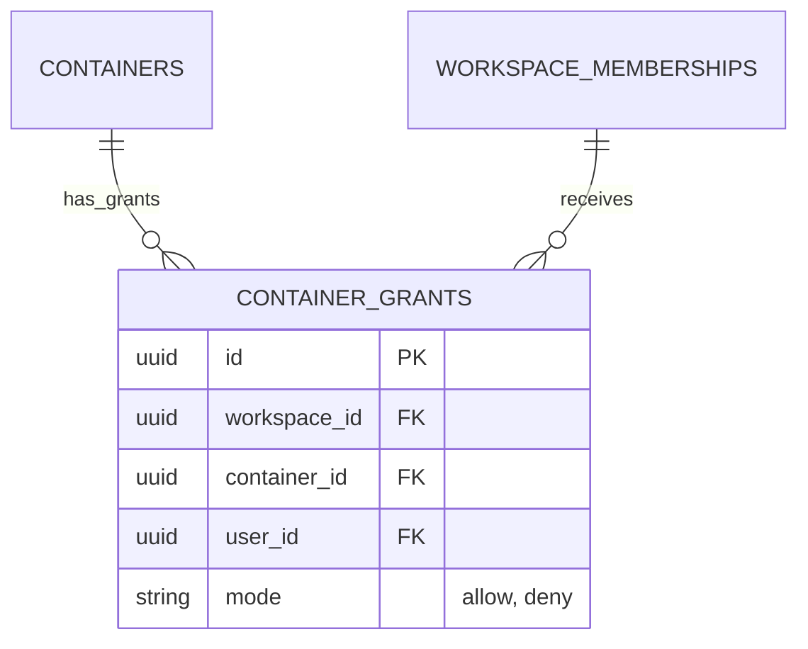
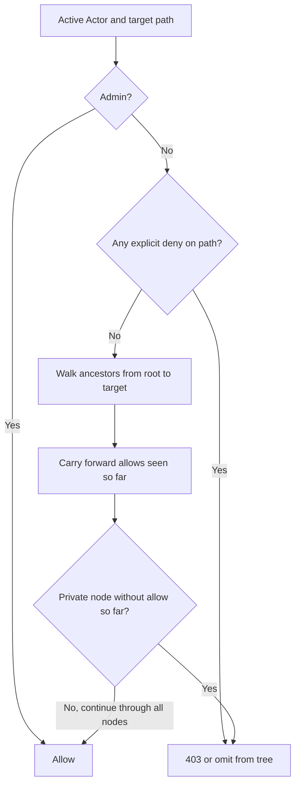
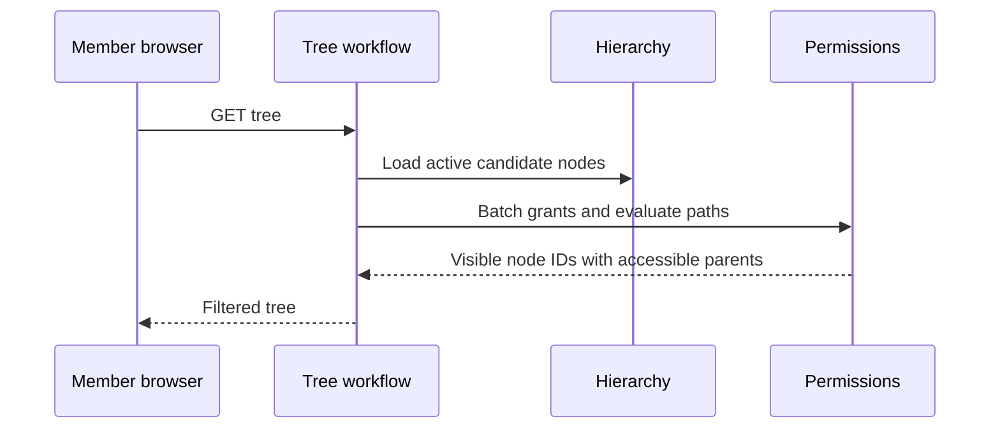

# Module: permissions

Status: Day 2 tree, list, and task access enforcement implemented; grant administration remains planned. Code owner: `apps/api/src/permissions`. Navigation: [hub](../README.md), [ADR-0002](../adr/0002-hierarchy-and-access.md), [hierarchy](hierarchy.md).

## 1. Purpose and example

Permissions decides which doors a signed-in person may open. Bob may be a workspace member without seeing every private list. Alice is an active admin and can see/administer the whole workspace.

Engineering and Q2 Launch are public. Security is private. Bob has allow on Security, so he can open it and edit its tasks. Carol has no allow and cannot see it. If Q2 Launch explicitly denies Bob, a Security allow does not bypass that denied ancestor.

Signing in is handled by identity. A private branch is not secured merely by hiding it in React. Backend tree, board, task, configuration, and move paths must use the same policy.

## 2. Ownership, data, and decisions

Grants belong to this module; users/memberships belong to identity and containers to hierarchy.

<!-- schema:start -->



<!-- schema:end -->

One grant per `(workspace_id, container_id, user_id)`; updating mode replaces that decision, not adds a conflicting second row. Composite FKs require a member and container in the same workspace.

| Decision                     | Result                                                                                                                |
| ---------------------------- | --------------------------------------------------------------------------------------------------------------------- |
| Membership first             | Inactive users/memberships are rejected before any admin bypass.                                                      |
| Admin                        | Active admin bypasses public/private/grant restrictions.                                                              |
| Deny precedence              | Any deny on the resource path blocks a member, even with a later allow.                                               |
| Private node                 | Needs an allow at that node or an already-visited ancestor. A later child allow cannot reopen an inaccessible parent. |
| Task edits vs administration | Members edit tasks in accessible lists; container/config/grant writes are admin-only.                                 |

Public nodes require active membership and no denied ancestor. An inherited allow can open private descendants unless a deny blocks them. Assignment never grants access. Team grants, role hierarchies, and per-action edit grants are future scope.

## 3. Connections and interfaces

| Connection     | Contract                                                                                                    |
| -------------- | ----------------------------------------------------------------------------------------------------------- |
| Identity       | Receives a trusted current Actor, never raw token/body roles. Workflow refreshes membership inside writes.  |
| Hierarchy      | Reads one ordered path from space to target; rejects archived or invalid scope through hierarchy.           |
| Workflows      | `assertCanReadContainer`, `assertCanEditTasks`, `assertAdmin`, filtered tree decisions, both sides of move. |
| Web            | Gets already-filtered data and optional capability flags; UI hiding never replaces a server check.          |
| Own repository | Loads grants in a bounded batch for the actor/path, avoiding per-node permission queries.                   |

Keep raw grant rows and blocking path details private from ordinary member error messages. A forbidden response must not list inaccessible sibling/container names. Admin config screens may show their own grant data.

The tree keeps accessible containers even if no visible children remain. It does not insert placeholders for private branches or promote children whose parents are hidden. The Work overview receives its list scope from this same filtered tree inside one read snapshot; private-list counts and task titles cannot leak through summary totals. Existing inaccessible resources return 403; missing/archived resources return 404 according to hierarchy rules.

## 4. Workflows and sequence diagrams

### Path evaluation



```mermaid
sequenceDiagram
    participant Web as Bob's browser
    participant Flow as Board workflow
    participant H as Hierarchy
    participant P as Permissions
    participant Config as Resolvers and tasks
    Web->>Flow: Open Security
    Flow->>H: Load active list and ancestor path
    Flow->>P: Evaluate current Actor against full path
    P->>P: Read relevant grants; deny/private rules
    alt Bob has valid access
        P-->>Flow: Allowed
        Flow->>Config: Load resolved board data
        Flow-->>Web: Board
    else Access blocked
        P-->>Flow: Forbidden
        Flow-->>Web: 403 without board/config data
    end
```

### Filter a tree



A task URL check resolves its actual list first. It must not rely on a caller-supplied list ID. A move checks access to the stored source and requested destination within the domain transaction.

### Change a grant

```mermaid
sequenceDiagram
    participant Admin as Alice's config UI
    participant Flow as Grant workflow
    participant ID as Identity
    participant H as Hierarchy
    participant P as Permissions
    participant DB as Transaction coordinator
    Admin->>Flow: Set allow/deny or remove explicit rule
    Flow->>DB: Begin and lock workspace
    Flow->>ID: Refresh active Actor and target membership
    Flow->>H: Check target active container and workspace
    Flow->>P: Require admin; upsert/delete owned grant
    Flow->>DB: Commit
    Note over Flow,P: Subsequent tree/task requests use the new rule
    Flow-->>Admin: Updated rule or no-content removal
```

Changing a container's public/private flag follows the hierarchy admin transaction and affects subsequent permission evaluation. It does not copy grants onto descendants or rewrite task assignments.

## 5. Build phases, failure cases, and change guide

Build the backend policy with hierarchy in Days 1-2, apply it to every workflow before UI completion, and add admin grant controls in Day 3. Do not defer enforcement until after task APIs exist.

| ID      | Test TODO: setup/action -> expected result                                                            |
| ------- | ----------------------------------------------------------------------------------------------------- |
| PERM-01 | Alice active admin -> all active branches and task edits/admin actions accessible.                    |
| PERM-02 | Bob opens tree and overview -> private Strategy and its task counts hidden; Security allow respected. |
| PERM-03 | Carol opens tree -> Roadmap visible through allowed Strategy; Delivery denied.                        |
| PERM-04 | Deny on parent and allow on child -> still 403; no child promoted into tree.                          |
| PERM-05 | Private parent without allow, allow only on child -> parent blocks access.                            |
| PERM-06 | Guessed task URL -> stored list's permissions enforced.                                               |
| PERM-07 | Assigned task in inaccessible list -> assignment does not make it visible.                            |
| PERM-08 | Inactive admin membership -> no bypass; reject.                                                       |
| PERM-09 | Member config/container/grant write -> 403 even if list accessible.                                   |
| PERM-10 | Move with either side inaccessible -> no mutation; no destination schema leak.                        |

Changing precedence or edit rights requires [ADR-0002](../adr/0002-hierarchy-and-access.md), the tree/direct-access examples, and all read/write workflow call sites to change together. Do not implement different permission algorithms per screen.
