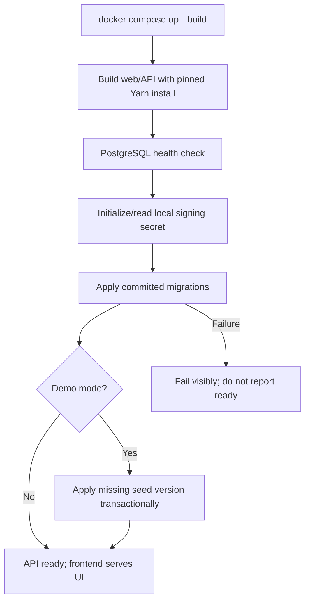
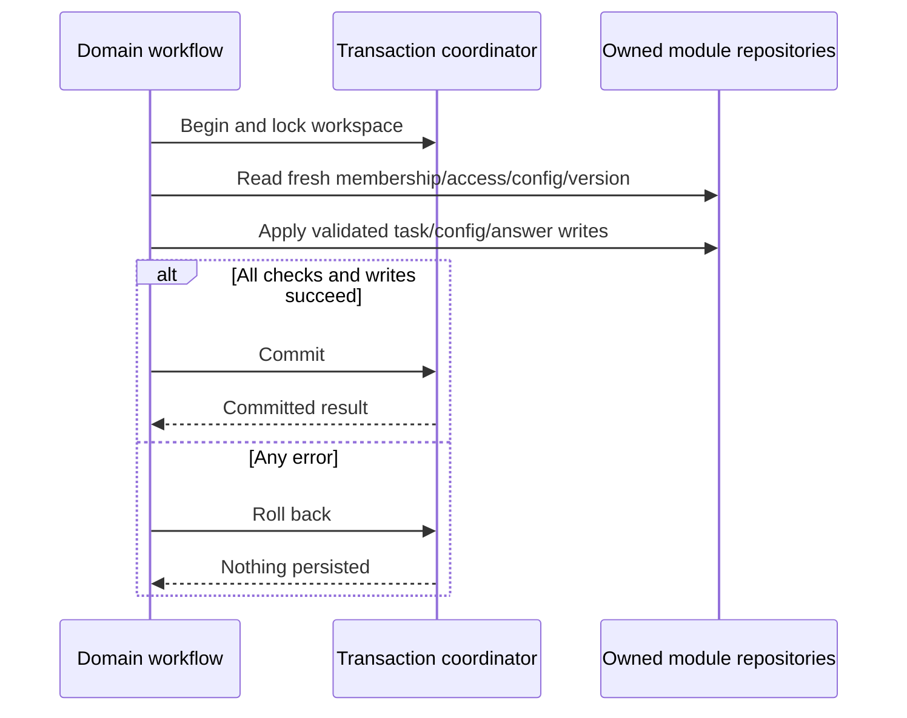

# Module: persistence and runtime

Status: Day 1 foundation implemented; later transaction/read-snapshot behavior remains planned. Code owner: `apps/api/src/persistence`, Docker/bootstrap and migration assets. Navigation: [hub](../README.md), [ADR-0005](../adr/0005-delivery-and-consistency.md), [complete ER](../er-diagram.md).

## 1. Purpose and example

This is the plumbing: it starts the app, stores data, and makes a multi-step change all-or-nothing. A reviewer should need only Docker, not a locally installed Node, Yarn, or PostgreSQL.

On first boot, PostgreSQL becomes ready, migrations create the agreed 16-table model, local signing material is initialized, and a deterministic seed supplies demo people/work. Restarting keeps edits instead of reseeding over them.

## 2. Ownership, data, and decisions

This library owns connection/transaction infrastructure and bootstrap tooling, not business repositories. It adds no business table. Prisma migration history and a seed-version marker are technical metadata outside the 16-table business count. Exact owned schemas live in the [module guides](../README.md) and are assembled in the [ER reference](../er-diagram.md).

| Runtime component | Behavior                                                                                             |
| ----------------- | ---------------------------------------------------------------------------------------------------- |
| web               | Build React/Vite; serve static UI and proxy `/v1` to API; port 8080.                                 |
| api               | Run NestJS on 3000 after bootstrap; same endpoints for browser and cookbook.                         |
| db                | PostgreSQL on internal network, persistent named data volume; no required public DB port.            |
| Signing material  | Local-demo named secret volume; generated once with restrictive permissions and not logged.          |
| Production        | Provision shared signing material; disable demo seeding; HTTPS/Secure-cookie configuration required. |

The supported command is `docker compose up --build`. Include `.env.example`, pinned tooling/lockfile, immutable installs, and multi-stage images. Local-demo is an explicit runtime setting, separate from NODE_ENV, so an optimized Docker build is still a local demo. No actual production keys/passwords are committed. A developer may opt into loopback-only database-client access through an untracked Compose override; the root README owns the exact local setup and connection values.

| Schema concern       | Rule                                                                                                                                                               |
| -------------------- | ------------------------------------------------------------------------------------------------------------------------------------------------------------------ |
| Ownership            | Each domain repository accesses its own tables; shared transactions do not expose sibling repositories.                                                            |
| Scope and hierarchy  | Composite FKs keep parents/lists/members/definitions in the same workspace; typed FKs and row checks enforce the strict container path and task-to-list placement. |
| Null owners          | Partial unique constraints distinguish a single workspace default set from local container sets.                                                                   |
| Identity/token chain | Composite same-user session identity and same-session refresh parent constraints; unique successor.                                                                |
| Time                 | PostgreSQL timestamptz in UTC for instants; field dates are validated YYYY-MM-DD values.                                                                           |

Use checked-in Prisma migrations and SQL for partial indexes/constraints that need explicit SQL. Do not rely only on application checks for same-user/same-workspace relationships. The strict parent and list types are database constraints; effective status, inherited field eligibility, archive/access, and answer validity remain in application workflows under the domain transaction. The scope migration checks existing rows before adding constraints and stops without modifying stored relationships if any are invalid.

## 3. Connections and interfaces

| Caller              | Infrastructure contract                                                                                             |
| ------------------- | ------------------------------------------------------------------------------------------------------------------- |
| Domain workflow     | Begin write transaction, lock workspace row, pass transaction context to owned module services, commit/rollback.    |
| Board workflow      | Repeatable-read transaction for one response's config/tasks/assignments/values snapshot.                            |
| Identity refresh    | Separate transaction; lock session then token, atomically consume/create or commit revocation.                      |
| Domain repositories | Same transaction-bound Prisma client through infrastructure; no independent transaction inside a coordinated write. |
| Bootstrap           | Database readiness -> migrations -> demo seed when enabled -> API readiness.                                        |

Local Compose has one API/bootstrap instance; run its initialization sequentially before listening. The startup script always applies migrations and runs the idempotent seed only when `FLOWBOARD_DEMO_MODE=true`; non-demo startup proceeds directly to the API. Production horizontal deployment would move migrations to one release job before starting replicas. Do not claim that scaling Compose API replicas makes concurrent bootstrap safe automatically.

Indexes cover credentials and issuer/subject lookup, session/user/expiry, refresh hash/session/parent, grant member/resource, container parent/order, task list/status/position, due date, and config owner. Task field values also index `(field_definition_id, workspace_id)` for FK maintenance. Add other custom-value indexes only when an actual filter query exists; custom-field filters are not scheduled.

## 4. Workflows and sequence diagrams

### Boot



```mermaid
sequenceDiagram
    participant Compose as Compose
    participant DB as PostgreSQL
    participant Boot as API bootstrap
    participant API as NestJS
    participant Web as Frontend
    Compose->>DB: Start persistent database
    DB-->>Compose: Healthy
    Compose->>Boot: Start API container
    Boot->>Boot: Load/create local secret without printing it
    Boot->>DB: Apply migrations
    alt Demo mode enabled
        Boot->>DB: Check seed marker; seed only if missing
        DB-->>Boot: Commit
    end
    Boot->>API: Start and expose readiness
    Web->>API: Proxy authenticated browser requests
```

### Atomic write and failure



Refresh replay is a different outcome: session revocation is a successful committed security write followed by HTTP 401. It is not a failed transaction to roll back.

### Seed fixture

| Data       | Exact target                                                                                                                                                        |
| ---------- | ------------------------------------------------------------------------------------------------------------------------------------------------------------------- |
| Root/tree  | One workspace; Engineering/Q2 Launch with Backlog, Delivery, Security; Product/Strategy with Roadmap.                                                               |
| Users/auth | Alice admin, Bob/Carol members; active users/memberships; user-owned password hashes; one local identity per user; no pre-seeded sessions/tokens.                   |
| Access     | Engineering/Q2 Launch/public Backlog/Delivery; private Security allows Bob; private Strategy allows Carol; Carol explicitly denied Delivery.                        |
| Config     | Workspace/Engineering Todo/In Progress/Done; Delivery Todo/Building/Review/Done; all six field types across levels and at least two custom columns per seeded list. |
| Tasks      | 24 tasks, six per list; varied statuses/priorities/assignees/dates; valid required/select values, including 0/false.                                                |

Engineering fields: effort/number required and work_type/single_select at space, tags/multi_select and target_date/date at folder, customer_note/text on Backlog, verified/checkbox on Delivery. Product has required impact/single_select at space and confidence/number at Strategy. The business walkthrough's required Delivery release_date/private Delivery are a separate fixture, not baseline seed facts.

Use fixed UUIDs and stable option IDs in the seed, one seed-version marker, and a transaction. If the marker exists, do not overwrite edits. Local demo login identifiers are `alice@flowboard.com`, `bob@flowboard.com`, and `carol@flowboard.com`; choose the documented development-only fixture password `FlowboardDemo!2026`, overridable by local seed configuration before first seed. They are local credentials owned by stable users, not production secrets or external-provider subjects. Existing seed/passwords are not changed by normal restarts. Production rejects demo seeding and requires provisioned configuration. A destructive reset is an explicitly separate command with confirmation.

## 5. Build phases, failure cases, and change guide

Build Compose, schema/constraints, signing bootstrap, and seed in Day 1; share transaction contexts with domain code in Day 2; verify clean startup/restart and final Docker test targets in Day 4. No Redis/worker/queue is required.

| ID     | Test TODO: setup/action -> expected result                                                                                   |
| ------ | ---------------------------------------------------------------------------------------------------------------------------- |
| RUN-01 | Clean machine with Docker only -> one command reaches ready and seeded UI.                                                   |
| RUN-02 | Restart after edits -> data and signing secret persist; no duplicate seed or password overwrite.                             |
| RUN-03 | Migration or enabled demo-seed failure -> no misleading readiness; seed transaction does not partially commit.               |
| RUN-04 | Composite-FK/type/unique violations -> same-workspace/user/session, strict parent, and task-list constraints enforced by DB. |
| RUN-05 | Multi-owner write fails midway -> all task/config data rolls back.                                                           |
| RUN-06 | Refresh replay -> revocation survives HTTP 401, unlike an ordinary rolled-back error.                                        |
| RUN-07 | Non-demo startup skips seed; production missing keys or demo-seed enabled -> fail closed; no secret in logs/artifacts.       |
| RUN-08 | Board response under config write -> internally consistent snapshot; no cross-request snapshot promise.                      |
| RUN-09 | Final test command -> PostgreSQL-backed backend tests and browser tests run without host tooling.                            |

When changing startup, constraints, or lock order, update runtime, affected owner docs, [ADR-0005](../adr/0005-delivery-and-consistency.md), `.env.example`/Compose/migrations when code exists, and clean-run TODOs. API processes are stateless with database-backed sessions; future replicas share keys and need shared throttling and a single migration job.
