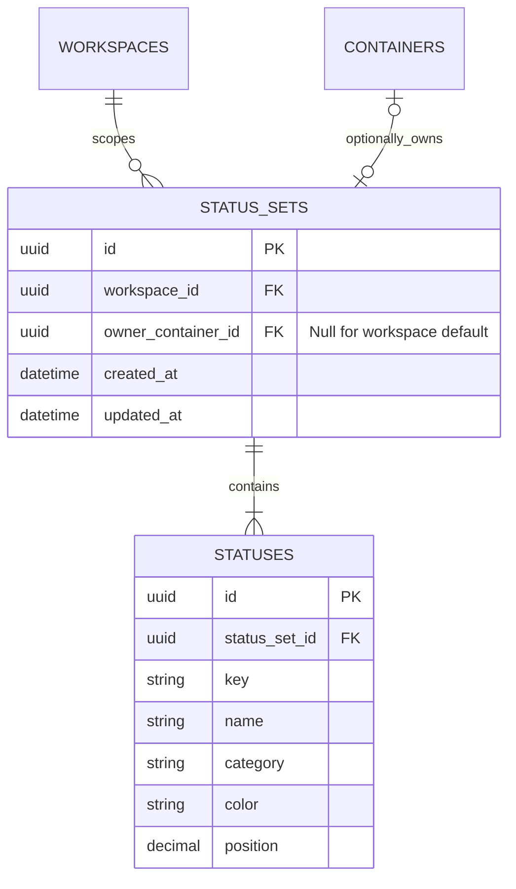
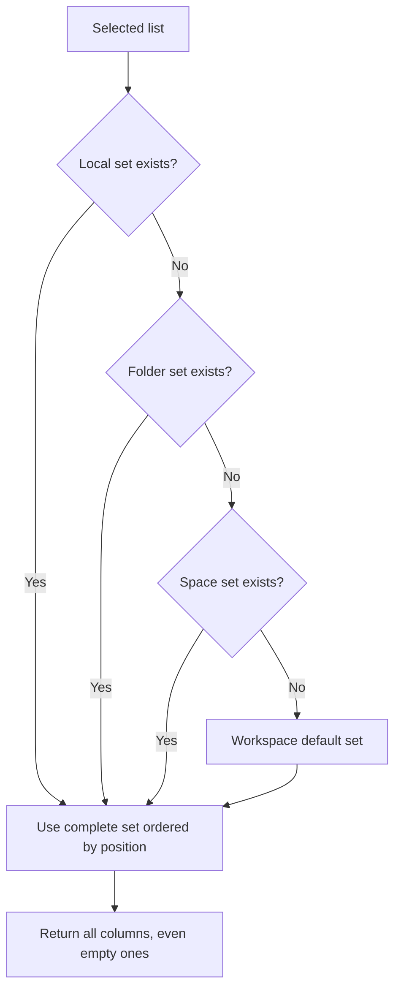
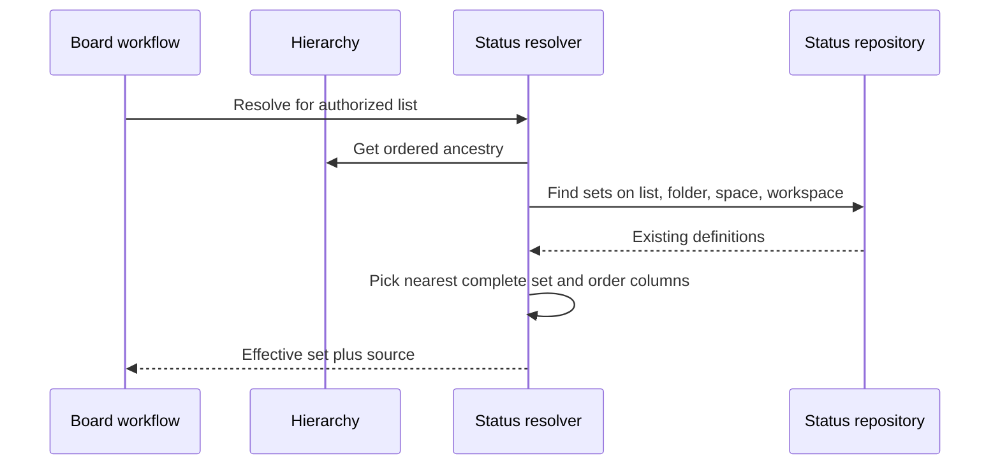

# Module: statuses

Status: planned. Code owner: `libs/api/statuses`. Navigation: [hub](../README.md), [ADR-0003](../adr/0003-scoped-configuration.md), [workflows](workflows.md).

## 1. Purpose and example

This module answers: "Which status columns apply to this list?" A status set is a complete menu of choices, not a global enum for every task.

Engineering defines Todo, In Progress, Done. Backlog has no local set and borrows Engineering's menu. Delivery defines Todo, Building, Review, Done, so it uses that whole local menu instead. The two lists share a folder but display different columns.

Editing Engineering's Todo label updates inheriting Backlog. It does not update Delivery's independent set. Copying an inherited set creates a local copy; it is no longer a live link.

## 2. Ownership, data, and decisions

<!-- schema:start -->



<!-- schema:end -->

One default set per workspace and at most one local set per space/folder/list. Partial unique constraints distinguish a null workspace-default owner from a local owner. Unique `(status_set_id, key)`; keys remain stable when labels/colors/order change. Categories are not_started, active, done, closed. Every complete set needs at least one not_started, active, and done; closed is optional.

| Decision              | Behavior                                                                               |
| --------------------- | -------------------------------------------------------------------------------------- |
| Nearest complete set  | Walk list -> folder -> space -> workspace default; stop at first set.                  |
| No implicit merging   | Child sets replace the whole inherited menu. No hide/merge-by-key rules.               |
| Stable task reference | Tasks store status_key, not a particular parent's status row ID.                       |
| Config safety         | Candidate edits cannot invalidate affected retained tasks, including archived records. |
| Admin configuration   | Members may change task status, but only admins change status definitions/sets.        |

`STATUSES.id` identifies a definition for administration. `key` identifies the semantic task status in an effective set. Two sets can both contain key `todo` with different labels. Task-to-status validity is therefore a resolver rule rather than a simple FK to one definition.

## 3. Connections and interfaces

| Consumer          | Public capability                                                                                                |
| ----------------- | ---------------------------------------------------------------------------------------------------------------- |
| Board workflow    | Resolve ordered status choices with effective owner and whether the selected list is local/inherited.            |
| Task workflows    | Validate a supplied key against the resolved list set.                                                           |
| Config workflow   | Build and validate a candidate set; compare effective outcomes; apply approved change within shared transaction. |
| Hierarchy         | Supply ancestor chain and descendant list candidates; no sibling repository queries.                             |
| Web config screen | View local/inherited configuration; copy parent into local set; edit local set; reset to inheritance.            |

The module does not query task tables. The config workflow asks tasks for usage through its public interface, supplies usage/results to validation, and only then calls status persistence. This avoids statuses importing tasks and tasks importing statuses.

Resolved API output must include ordered definition IDs, stable keys, labels, categories, colors, positions, and source owner. Workspace defaults use a workspace source; container source type is derived from hierarchy. All HTTP route names are in [API/contracts](api-contracts.md).

## 4. Workflows and sequence diagrams

### Resolve the board columns





### Remove a status or reset an override

```mermaid
sequenceDiagram
    participant Web as Admin config UI
    participant Flow as Config workflow
    participant H as Hierarchy
    participant S as Status service
    participant T as Task query service
    participant DB as Transaction coordinator
    Web->>Flow: Propose status removal or reset
    Flow->>DB: Begin; lock workspace; refresh admin authorization
    Flow->>S: Build candidate without persisting it
    Flow->>H: Find descendant lists, including retained archived branches
    Flow->>S: Compare effective current and candidate sets
    Flow->>T: Check retained tasks in affected lists
    alt Every set and stored task remains valid
        Flow->>S: Persist candidate
        Flow->>DB: Commit
        Flow-->>Web: Updated configuration
    else Invalid set or referenced missing status
        Flow->>DB: Roll back
        Flow-->>Web: 400 for invalid set or 409 for in-use change
    end
```

A lower override shields its lists from ancestor changes until that override is removed. For a list inheriting the changed owner, revalidate all retained tasks, not only the visible board page. The admin may receive useful blocker counts; no silent task remapping is performed.

## 5. Build phases, failure cases, and change guide

Build resolution/model in Day 2, apply to tasks/board immediately, and add space/list config UI and candidate safety in Day 3. Keep the workspace default available from initial seed.

| ID        | Test TODO: setup/action -> expected result                                                               |
| --------- | -------------------------------------------------------------------------------------------------------- |
| STATUS-01 | No local/folder/space set -> workspace default.                                                          |
| STATUS-02 | Sets at several levels -> nearest complete set; no merge.                                                |
| STATUS-03 | Backlog and Delivery under one folder -> different correct columns, including empty columns.             |
| STATUS-04 | Missing required category -> 400; duplicate key in set -> reject.                                        |
| STATUS-05 | Task create/update unknown key -> 400.                                                                   |
| STATUS-06 | Remove referenced key -> 409; no task/board orphan.                                                      |
| STATUS-07 | Reset override to incompatible ancestor -> 409 and original local set retained.                          |
| STATUS-08 | Edit ancestor -> only lists whose effective set changes are checked; lower override remains independent. |
| STATUS-09 | Rename/color/reorder -> task keys unchanged and board order updated.                                     |
| STATUS-10 | Reference held only by archived task -> destructive change still blocked.                                |

Changing replacement behavior, stable keys, or safety policy requires [ADR-0003](../adr/0003-scoped-configuration.md), move/config workflow updates, frontend inherited/local explanations, and the derived ER if schema changes.
