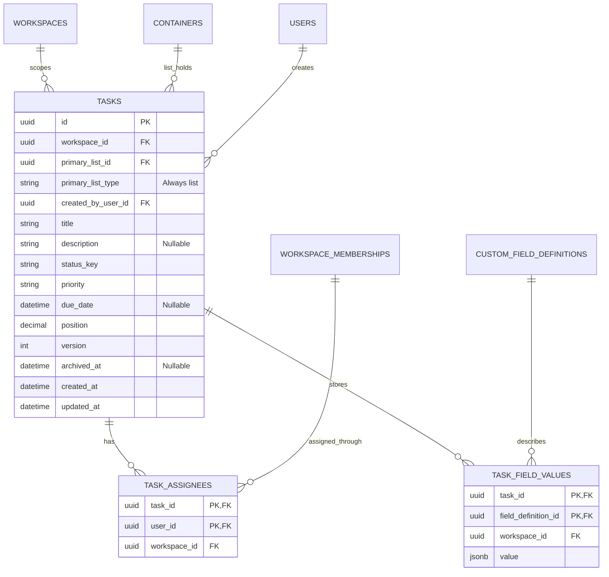
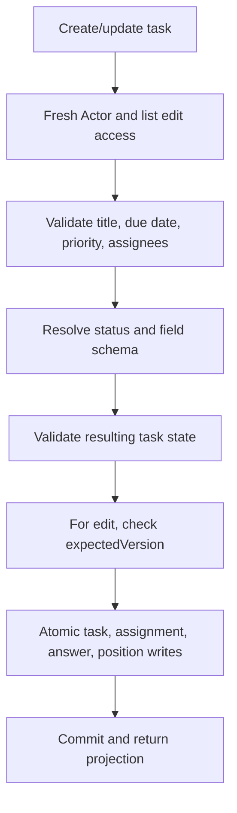

# Module: tasks

Status: Day 2 reads, create/edit/archive, placement, move, answers, and assignments implemented; Day 3 UI completion and Day 4 tests remain planned. Code owner: `apps/api/src/tasks`. Navigation: [hub](../README.md), [workflows](workflows.md), [fields](custom-fields.md), [statuses](statuses.md).

## 1. Purpose and example

A task is one piece of work, such as Fix login. It has one primary list, built-in details, assignees, and custom answers. A board card and a table row are two views of the same task record.

Task T1 belongs to Backlog, has status_key=in_progress, priority=high, assignee Bob, and Effort=3. Dragging it to Done changes its status and placement, not its list. Moving it to Delivery changes its governing list and requires the move workflow to revalidate status, custom fields, and access.

## 2. Ownership, data, and decisions

Tasks owns stored custom answers and assignment links, while field definitions and workspace membership belong elsewhere.

<!-- schema:start -->



<!-- schema:end -->

| Field or relation | Rule                                                                                               |
| ----------------- | -------------------------------------------------------------------------------------------------- |
| title             | Required after trimming, 1-500 characters.                                                         |
| description       | Optional plain text/markdown text; render safely, without executing HTML.                          |
| primary_list_id   | Required, exactly one list in the same workspace. No task folder/space/workspace direct placement. |
| status_key        | Required on create; valid in effective list set. Stable key, not a direct definition-row FK.       |
| priority          | urgent, high, normal, low, none; default none when omitted.                                        |
| assignees         | Zero or more distinct active workspace members; assignment does not grant access.                  |
| due_date          | Optional valid ISO datetime; null clears.                                                          |
| position          | Server-owned dense order inside one `(list, status_key)` group.                                    |
| version           | Starts at 1; every task mutation increments it; writes require expectedVersion.                    |
| custom values     | One row per task/definition; missing optional row means no answer; null patches remove rows.       |

Workspace-scoped composite FKs protect list, task, assignment membership, and definition scope. Unique task/user and task/definition pairs prevent duplicate links/answers. Creator is a stable internal user ID, never a provider subject.

`primary_list_type` is an internal key defaulted to `list` and fixed by a database check. The `(primary_list_id, workspace_id, primary_list_type)` FK requires an actual list in that workspace. Assignments and answers also reference `(task_id, workspace_id)`; answers additionally reference `(field_definition_id, workspace_id)`. The workflow still checks active membership, access, effective status, and inherited field eligibility, which cannot be inferred from these structural FKs alone.

Tasks archive rather than physically delete. Parent-container archival also hides the task. Retained archived tasks remain visible to internal config-usage checks. Public restore/subtasks/secondary memberships are outside scope.

## 3. Connections and interfaces

| Caller                                | Capability                                                                                                                                                   |
| ------------------------------------- | ------------------------------------------------------------------------------------------------------------------------------------------------------------ |
| Workflows                             | Read stored task/list/version, create/update/archive, placement/move writes, assignee/value replacement within a transaction.                                |
| Config safety workflow                | Query all retained status/field/option usage in supplied list scopes, without filtering out archived tasks.                                                  |
| Board/list workflow                   | Paginated task projections and built-in sort; include assignees/value data in bounded queries.                                                               |
| Overview workflow                     | Count active tasks by authorized list IDs and return only bounded future-due summaries; caller supplies accessible list scope, Tasks does not decide access. |
| Identity via workflows                | Supply validated eligible assignee IDs.                                                                                                                      |
| Status/field validation via workflows | Supply validated destination key and definition-ID values; task service does not read config tables.                                                         |

Task writes are internal application capabilities for workflows, not a permission-free public HTTP API. Keep task controllers behind workflows. Task service imports neither permissions nor status/field services, preventing circular ownership.

The API uses customFields maps of stable keys, while persistence uses definition IDs. Workflows obtain key/definition mapping from the field resolver. Query projections never contain credentials/tokens or inaccessible destination details.

## 4. Workflows and sequence diagrams

### Create and edit



```mermaid
sequenceDiagram
    participant Web as Task drawer
    participant Flow as Task workflow
    participant Config as Identity/status/field services
    participant T as Task service
    participant DB as Transaction coordinator
    Web->>Flow: Create task with title, status, values
    Flow->>DB: Begin; lock workspace; authorize list
    Flow->>Config: Validate assignees and resolved config
    Flow->>T: Insert task, assignments, answers, append position
    Flow->>DB: Commit
    Flow-->>Web: Task with version 1
    Web->>Flow: Edit with expectedVersion 1
    Flow->>DB: Begin; lock and authorize
    Flow->>T: Load current version
    alt Current version is 1 and resulting task is valid
        Flow->>T: Persist change and version 2
        Flow->>DB: Commit
        Flow-->>Web: Updated task
    else Stale or invalid
        Flow->>DB: Roll back
        Flow-->>Web: 409 stale or 400 invalid
    end
```

### Placement and archival

```mermaid
sequenceDiagram
    participant Web as Kanban
    participant Flow as Placement workflow
    participant S as Status resolver
    participant T as Task service
    participant DB as PostgreSQL
    Web->>Flow: Target status, optional beforeTaskId, expectedVersion
    Flow->>DB: Lock workspace; refresh access and version
    Flow->>S: Validate target status for stored list
    Flow->>T: Validate anchor in destination column
    Flow->>T: Update status and dense positions in affected groups
    Flow->>DB: Commit
    Flow-->>Web: Confirmed task/placement; invalidate affected query
```

Position inputs are an insertion anchor, not arbitrary client ranks. Omitted anchor appends. Reindex affected source/destination groups inside the transaction. An anchor must be another active task in the destination list/status. Reordering does not alter parent list. Cross-list movement is specified in [workflows](workflows.md).

Archive checks current version/access and marks the task archived, removes it from normal views, and compacts its prior placement group. Preserve assignments and values. This makes future config safety checks honest about retained references.

## 5. Build phases, failure cases, and change guide

Build the task repository/use cases and form/query integration in Day 2. Finish move/placement UX and sorting in Day 3. Built-in list sorting is due date or priority, with stable ID tie-breaking. Default board order is configured status order then task position/ID; null due dates sort last, and priority order is urgent -> high -> normal -> low -> none.

| ID      | Test TODO: setup/action -> expected result                                                                                                  |
| ------- | ------------------------------------------------------------------------------------------------------------------------------------------- |
| TASK-01 | Valid create -> one task/list, version 1, valid assignments/values.                                                                         |
| TASK-02 | Blank/over-500 title, invalid enum/date, inactive/foreign assignee -> 400.                                                                  |
| TASK-03 | API or direct DB task placement under folder/space or foreign-workspace list -> reject.                                                     |
| TASK-04 | Update omits value vs explicit null -> preserve vs clear per field validation.                                                              |
| TASK-05 | Stale expectedVersion -> 409, no partial task/answer writes.                                                                                |
| TASK-06 | Status change/reorder -> correct column and persisted dense placement; no list change.                                                      |
| TASK-07 | Foreign/mismatched/self anchor -> reject; empty-column append works.                                                                        |
| TASK-08 | Archive -> hidden normally, retained references still found by config checks.                                                               |
| TASK-09 | Paginated/sorted results -> stable ties, null due dates last, documented priority order.                                                    |
| TASK-10 | Internal member/provider migration -> task IDs/assignees/creator remain stable.                                                             |
| TASK-11 | Authorized list-scope overview -> active counts, seven-day due-soon count, and five future-due summaries are correctly bounded and ordered. |

For changes, update task contracts and [workflows](workflows.md) first if authorization/config/atomicity is affected. New task fields need persistence, drawer/table projections, examples, and TODOs together. Do not add a task-to-global-status FK that bypasses scoped resolution.
