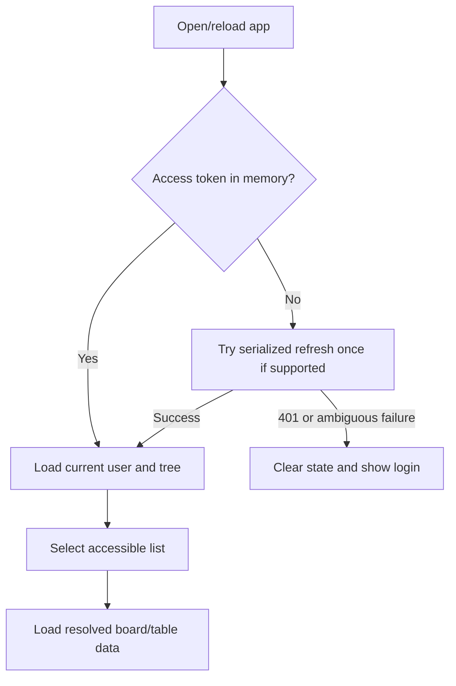
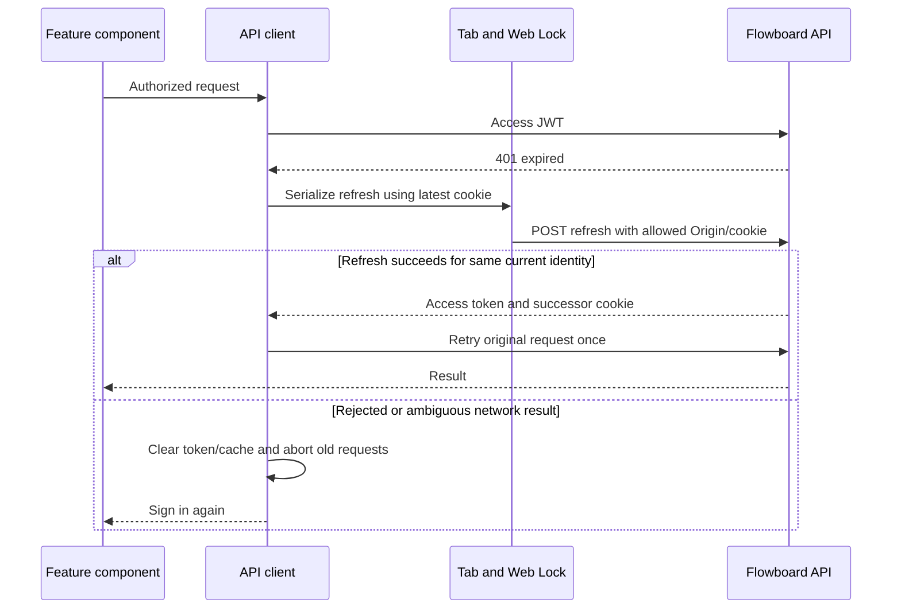
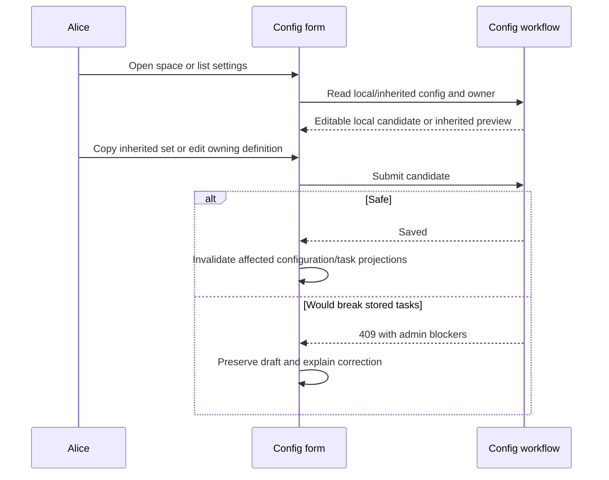

# Module: web client

Status: Day 1 identity/session UI and dashboard landing implemented; board, task, and configuration UX remain planned. Code owner: `apps/web/src`. Navigation: [hub](../README.md), [API/contracts](api-contracts.md), [identity](identity.md), [ADR-0001](../adr/0001-modular-monolith.md).

## 1. Purpose and example

The web client makes the business rules understandable. Alice signs in, selects Backlog, sees its columns, opens Fix login, edits Effort, and saves. Bob later signs in and sees a smaller tree. The client explains rules returned by the server instead of inventing a competing permission or inheritance engine.

React uses Ant Design for forms/table/tree/drawer/configuration and dnd-kit for kanban placement. React Router holds navigation; TanStack Query manages server data. Local selection, open drawers, and pending states are UI state, not extra database tables.

## 2. Ownership, data, and decisions

| UI area             | Planned components and behavior                                                                                                        |
| ------------------- | -------------------------------------------------------------------------------------------------------------------------------------- |
| Login/session       | Implemented: AntD sign-in form, centralized in-memory session/API client, refresh-on-load, and sign out. Sign out all remains planned. |
| Shell/navigation    | Layout, Tree, Breadcrumb; server-filtered collapsible hierarchy.                                                                       |
| Kanban              | Resolved columns including empty ones; cards with title, assignees, priority, due date; dnd-kit.                                       |
| Task table          | Built-ins plus at least two resolved custom-field columns; due-date/priority sorting; click row to drawer.                             |
| Task drawer/move    | Form fields generated from resolved schema; built-ins; destination correction dialog; saved version.                                   |
| Admin configuration | Simple space/list status forms, field/options forms, container/grant forms, owner/inherited labels and safety errors.                  |

The client owns no business ER table. All stored task/config/membership data comes from the API. Access tokens remain in memory; refresh tokens are HttpOnly cookies managed by the browser. No token localStorage persistence or direct provider SDK use is allowed here for the MVP.

| Decision                      | Reason                                                                                           |
| ----------------------------- | ------------------------------------------------------------------------------------------------ |
| Server-resolved configuration | Ensures columns and forms match validation.                                                      |
| Confirmed mutations           | Keep pending indicators and apply/refetch confirmed results; optimistic conflict UI is deferred. |
| Identity-scoped queries       | Include current internal user, workspace, and relevant list in cache keys.                       |
| No aggregate boards           | Different lists can resolve different status sets, so only selected-list views are required.     |
| Server-backed permissions     | Hide unsupported admin controls for clarity, but rely on server authorization for security.      |

Field inputs: text -> Input/TextArea, number -> InputNumber, single/multi-select -> Select, date -> DatePicker, checkbox -> Checkbox. Bind checkbox values explicitly as booleans so false is not lost. Date inputs send YYYY-MM-DD; due dates send ISO datetimes. Avoid numeric-string coercion. Render description/labels safely, without executing user HTML.

## 3. Connections and interfaces

All HTTP shapes/routes are owned by [API/contracts](api-contracts.md). The client imports shared contracts, not backend services. The API client injects the current access token; feature components do not construct auth headers.

| Boundary              | Data used                                                                                                 |
| --------------------- | --------------------------------------------------------------------------------------------------------- |
| Identity              | Login/refresh response and GET me; memory token/current user; refresh cookie via same-origin credentials. |
| Hierarchy/permissions | Filtered tree and authorized selections; discard forbidden/deleted/archived current selection.            |
| Board/list            | Resolved status/schema and task pages; load selected list's pages for this small MVP.                     |
| Task mutation         | Expected version, desired field changes, and placement/move corrections.                                  |
| Config mutation       | Explicit local vs inherited owner; show admin blocker information without discarding edits.               |

Opening a destination selector uses only visible lists. Obtain its resolved config before allowing a move correction. Show which source-only values must be explicitly cleared. A role/provider/body field is never sent as authority.

## 4. Workflows and sequence diagrams

### Page reload and expiry





Use Web Locks to coordinate refresh across tabs; a browser lacking it signs in again when its access token expires. Do not automatically retry refresh itself after an ambiguous network failure. Do not refresh on ordinary 403 validation/permission errors. Never retry an already-successful mutation just because rendering failed.

Broadcast login/logout/identity changes across tabs. A different current identity must cancel prior in-flight work, clear selection/drawers/cache, and must not replay an old user's request with the new user's token. Other devices' sessions remain independent unless logout-all is used.

### Task edit and move

```mermaid
sequenceDiagram
    participant User as Alice or Bob
    participant Drawer as Task drawer
    participant API as Task/config API
    User->>Drawer: Open task
    Drawer->>API: Task plus resolved fields
    API-->>Drawer: Current values, version, schema
    User->>Drawer: Edit Effort
    Drawer->>API: PATCH with expectedVersion
    alt Saved
        API-->>Drawer: Updated task and version
        Drawer->>Drawer: Refresh affected board/table/detail queries
    else Invalid or stale
        API-->>Drawer: Field-path 400 or stale 409
        Drawer->>Drawer: Show error; do not claim save succeeded
    end
    User->>Drawer: Choose destination list
    Drawer->>API: Authorized destination configuration
    Drawer->>Drawer: Explain missing status/required values/source-only clears
    Drawer->>API: Explicit corrected move and version
    API-->>Drawer: Confirmed task or unchanged-source error
```

### Configuration



Selecting a workspace/space/folder navigates or configures that container; boards belong to selected lists. Empty accessible containers remain visible. Card status/position changes do not move lists. A failed drag shows the server result and an error rather than leaving a falsely saved card.

## 5. Build phases, failure cases, and change guide

Build login/session integration and shell early, board/table/drawer in Day 2, config/move/grant completion in Day 3, and browser tests in Day 4. Desktop-first clarity is the target; responsive polish is optional.

| ID     | Test TODO: setup/action -> expected result                                                                                            |
| ------ | ------------------------------------------------------------------------------------------------------------------------------------- |
| WEB-01 | Login -> select Backlog -> expected columns -> open task -> edit custom field -> save/persist.                                        |
| WEB-02 | Login as Alice, logout, login as Bob -> private lists disappear and no Alice cache/drawer data survives.                              |
| WEB-03 | Access expiry with concurrent requests/tabs -> serialized refresh and one original-request retry; no accidental replay family branch. |
| WEB-04 | Different user signs in another tab -> clear/abort old identity work; no mutation replay under new user.                              |
| WEB-05 | Invalid custom value/stale edit -> exact error shown, no claimed save or lost draft.                                                  |
| WEB-06 | Drag to status/reorder -> confirmed placement; denied/failed drag -> restored/refetched server result.                                |
| WEB-07 | Required checkbox false and number 0 -> both preserved; field date/due datetime use correct formats.                                  |
| WEB-08 | Config screen at space/list -> correct owner/inherited status, safe reset, 409 blockers.                                              |
| WEB-09 | Reload, logout-all, unsupported refresh coordination, lost refresh response -> correct login/reset behavior.                          |
| WEB-10 | Board/table -> same tasks, at least two custom columns, due-date/priority sorts, empty states.                                        |

When changing a screen, identify whether it is presentation-only or changes a domain contract. Update the owning business module first for rule changes, then contracts/API client/forms/cache invalidation and browser TODOs. Do not copy permission or inheritance rules into components.
