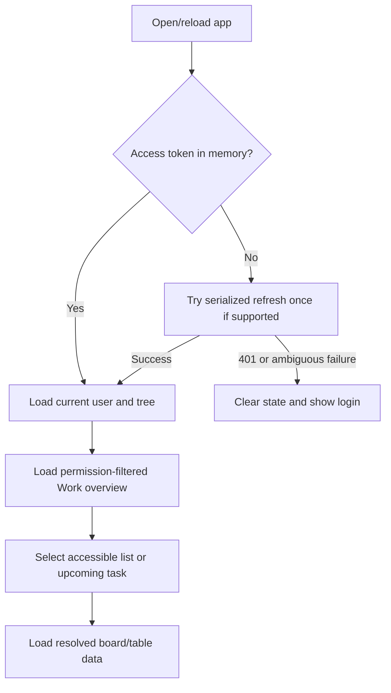
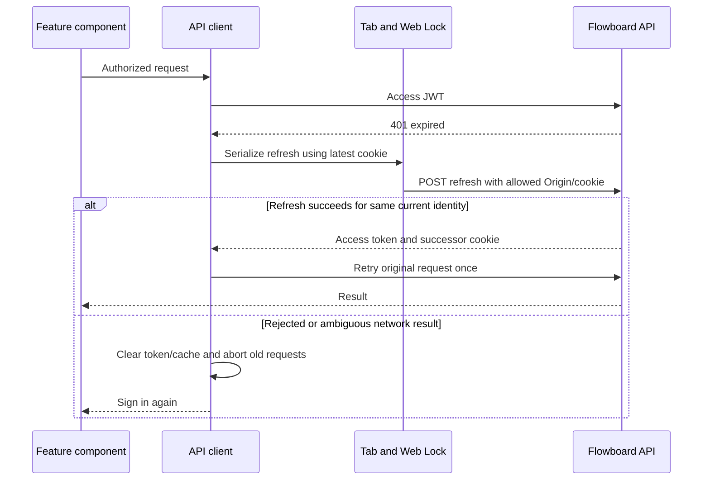
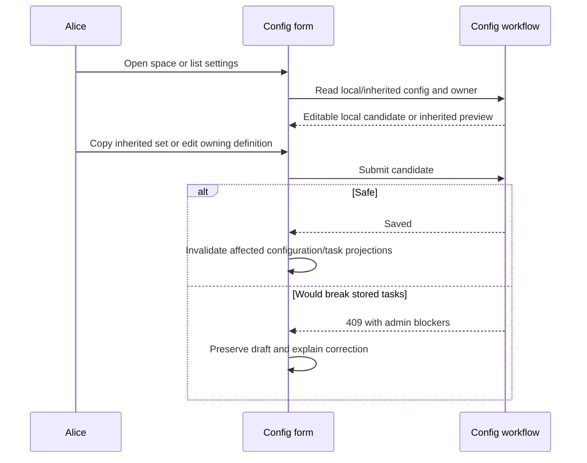

# Module: web client

Status: Day 1–2 login/task views and Day 3 admin configuration, grants, hierarchy, and move correction UI added; manual admin runtime review completed, other web TODOs and executable application tests pending. Code owner: `apps/web/src`. Navigation: [hub](../README.md), [API/contracts](api-contracts.md), [identity](identity.md), [ADR-0001](../adr/0001-modular-monolith.md).

## 1. Purpose and example

The web client makes the business rules understandable. Alice signs in to Work overview, opens Backlog, sees its columns, opens Fix login, edits Effort, and saves. Bob later signs in and sees an overview and tree limited to his accessible lists. The client explains rules returned by the server instead of inventing a competing permission or inheritance engine.

React uses Ant Design for forms, table, tree, modal, and drawer. Day 2 uses native desktop drag events for kanban placement, React state for list selection, and confirmed API refetches for server data. Route-aware navigation and richer query caching can be added after the required views are stable. Local selection, open task surfaces, and pending states are UI state, not extra database tables.

The current client is sized for the MVP dataset. The code-backed growth risks and a measurement-first optimization order are recorded in the [web performance guide](../web-performance.md); they are future work, not implemented behavior.

## 2. Ownership, data, and decisions

| UI area          | Planned components and behavior                                                                                                                                                                                                                                                                                                                    |
| ---------------- | -------------------------------------------------------------------------------------------------------------------------------------------------------------------------------------------------------------------------------------------------------------------------------------------------------------------------------------------------- |
| Login/session    | Implemented: AntD sign-in form, in-memory access token, refresh-on-load, and Axios 401 interceptor. It serializes refresh within/across tabs, retries each protected request once, and clears the local session if refresh fails. Sign out all remains planned.                                                                                    |
| Shell/navigation | Implemented: two-pane layout, Home/Create entries, admin-only Admin entry, Tree, Breadcrumb, server-filtered collapsible hierarchy; Work overview is the default after login. The header shows a current-user initial avatar that opens name, role, email, and Sign Out.                                                                           |
| Work overview    | Implemented: live visible-task/list/due-soon totals, per-list counts, and upcoming due dates; list and task links enter the existing Board view. Empty states handle no accessible lists or upcoming tasks.                                                                                                                                        |
| Kanban           | Implemented: resolved columns including empty ones; cards with title, assignees, colored priority, due date; desktop drag placement. Selecting a card opens a wide modal.                                                                                                                                                                          |
| Task table       | Implemented: built-ins and resolved custom-field columns, due-date/priority sorting; selecting a row opens a right-side drawer.                                                                                                                                                                                                                    |
| Task detail/move | Built-ins and inputs generated from resolved schema, task create/edit, saved version; Day 3 destination selector loads resolved config and requires source-only clears.                                                                                                                                                                            |
| Hierarchy/config | A shared creation form lets members create spaces/folders/lists under accessible parents and also appears in Admin hierarchy. Creators can share their own containers from Create or a list board. Admin tabs handle all grants plus hierarchy edits, local status sets/reset with preview, and drag-ordered fields. Failed saves preserve drafts. |

The client owns no business ER table. All stored task/config/membership data comes from the API. Access tokens remain in memory; refresh tokens are HttpOnly cookies managed by the browser. No token localStorage persistence or direct provider SDK use is allowed here for the MVP.

| Decision                      | Reason                                                                                                                                                                                                                                       |
| ----------------------------- | -------------------------------------------------------------------------------------------------------------------------------------------------------------------------------------------------------------------------------------------- |
| Server-resolved configuration | Ensures columns and forms match validation.                                                                                                                                                                                                  |
| Server-owned overview         | One authorized read model counts only active tasks in accessible active lists; no browser aggregation across private lists. Due soon means from the response time to seven days later; upcoming items are the five nearest future due dates. |
| Confirmed mutations           | Keep pending indicators and apply/refetch confirmed results; optimistic conflict UI is deferred.                                                                                                                                             |
| Identity-scoped state         | Clear selected list, board, drawer, and pending work when the signed-in identity changes.                                                                                                                                                    |
| No aggregate boards           | Different lists can resolve different status sets, so only selected-list views are required.                                                                                                                                                 |
| Server-backed permissions     | Hide unsupported admin controls for clarity, but rely on server authorization for security.                                                                                                                                                  |

Field inputs: text -> Input/TextArea, number -> InputNumber, single/multi-select -> Select, date -> native date input, checkbox -> Checkbox. Bind checkbox values explicitly as booleans so false is not lost. Date inputs send YYYY-MM-DD; due dates send ISO datetimes. Avoid numeric-string coercion. Render description/labels safely, without executing user HTML.

## 3. Connections and interfaces

All HTTP shapes/routes are owned by [API/contracts](api-contracts.md). The client imports shared contracts, not backend services. The API client injects the current access token; feature components do not construct auth headers.

| Boundary              | Data used                                                                                                                       |
| --------------------- | ------------------------------------------------------------------------------------------------------------------------------- |
| Identity              | Login/refresh response and GET me; memory token/current user; refresh cookie via same-origin credentials.                       |
| Hierarchy/permissions | Filtered tree and authorized selections; discard forbidden/deleted/archived current selection.                                  |
| Workspace overview    | Authorized workspace summary; task/list counts and upcoming items come from the server, while Home selection is local UI state. |
| Board/list            | Resolved status/schema and task pages; load selected list's pages for this small MVP.                                           |
| Task mutation         | Expected version, desired field changes, and placement/move corrections.                                                        |
| Config mutation       | Explicit local vs inherited owner; show admin blocker information without discarding edits.                                     |

Opening a destination selector uses only visible lists. Obtain its resolved config before allowing a move correction. Show which source-only values must be explicitly cleared. A role/provider/body field is never sent as authority.

## 4. Workflows and sequence diagrams

### React component workflow

The browser entry mounts one application root. Session restoration and login state live at the app boundary; the dashboard coordinates the selected workspace surface. Feature editors own their draft state, while `session-client` owns HTTP and refresh behavior. A component file is a useful default when a component has its own responsibility, state, or reuse; small helpers and tightly related presentational pieces may remain beside their owner. The goal is clear ownership, not one function per file.

```mermaid
sequenceDiagram
    participant Main as main.tsx
    participant App as App
    participant Session as session-client
    participant Login as LoginScreen
    participant Dash as Dashboard
    participant Home as WorkspaceHome
    participant Board as Board and Table surface
    participant Editor as TaskEditor
    participant Move as TaskMove
    participant Admin as AdminPanel
    participant AdminTab as Status, Fields, Grants, or Hierarchy editor
    participant Create as ContainerCreator
    participant API as Flowboard API

    Note over Main: Mounts React once and enables StrictMode checks during development.
    Main->>App: Render application root
    Note over App: Owns restored session, signed-in actor, access token, and sign-in/out transitions.
    App->>Session: Restore session with refresh cookie
    Session->>API: POST refresh
    API-->>Session: Access token
    Session-->>App: Access token
    App->>Session: Load current actor
    Session->>API: GET /v1/me with access token
    API-->>Session: Current actor
    Session-->>App: Actor
    alt Session unavailable
        App->>Login: Render sign-in surface
        Note over Login: Collects credentials and presents authentication errors; does not call API directly.
        Login->>App: Submit credentials
        App->>Session: Login
        Session->>API: POST login
        API-->>Session: Access token
        Session-->>App: Access token
        App->>Session: Load current actor
        Session->>API: GET /v1/me with access token
        API-->>Session: Current actor
        Session-->>App: Actor
    end
    App->>Dash: Render with actor and token
    Note over Dash: Coordinates navigation, selected list, loaded data, and task/config workflows.
    Dash->>Session: Load tree, members, overview, board, or task
    Session->>API: Authorized API request
    API-->>Session: Permission-filtered data and resolved configuration
    Session-->>Dash: Typed result
    alt Home selected
        Dash->>Home: Render overview and navigation callbacks
        Note over Home: Displays server-calculated counts and due items; emits list/task selections.
    else List selected
        Dash->>Board: Render kanban or table surface
        Note over Board: Presents server-loaded tasks; reports open-task and placement intents.
        Board->>Editor: Open task or create task
        Note over Editor: Owns task form draft and validates/presents save feedback.
        Editor->>Dash: Submit task changes
        Dash->>Session: Create/update task
        Session->>API: Mutation with expected version
        API-->>Session: Confirmed task result or error
        Session-->>Dash: Mutation result
        Dash->>Board: Refresh confirmed list data
        opt Move task to another list
            Editor->>Move: Open destination correction flow
            Note over Move: Loads destination config and gathers status, field, and source-only clear choices.
            Move->>Session: Load config and submit move
            Session->>API: Authorized move request
            API-->>Session: Confirmed move or validation error
            Session-->>Dash: Refresh source list after confirmed move
        end
    else Create selected by a member or admin
        Dash->>Create: Render container creation form with visible parent choices
        Create->>Session: Submit space, folder, or list creation
        Session->>API: POST /v1/containers
        API-->>Session: Created container or access error
        Session-->>Create: Confirmation or error
        Create-->>Dash: Refresh permission-filtered tree
    else Admin selected by an admin actor
        Dash->>Admin: Render administration surface
        Note over Admin: Selects configuration owner and routes to the matching admin editor.
        Admin->>AdminTab: Render selected tab editor
        Note over AdminTab: Owns its focused draft and preserves it when the server rejects a save.
        AdminTab->>Session: Read or save hierarchy/config/grant data
        Session->>API: Authorized API request
        API-->>Session: Data, confirmation, or blocker details
        Session-->>AdminTab: Result for display
        AdminTab-->>Dash: Notify successful change
    end
```

Dashboard files are grouped by feature: [dashboard.tsx](../../apps/web/src/dashboard/dashboard.tsx) coordinates the surfaces; [admin/](../../apps/web/src/dashboard/admin/admin-panel.tsx) contains the owner/tab selector and its status, fields, grants, and hierarchy editors; [tasks/](../../apps/web/src/dashboard/tasks/task-editor.tsx) contains task editing and move correction; and [home/](../../apps/web/src/dashboard/home/workspace-home.tsx) contains the workspace overview. `main.tsx` wraps the root in React `StrictMode` so effect cleanup and render assumptions are checked during development.

### Page reload and expiry





The Axios response interceptor refreshes only protected requests that receive 401; it does not refresh on 403 or retry login/refresh. Protected logout requests can refresh and retry because authentication rejects them before logout runs. Each original request is retried at most once. Use a shared in-tab refresh promise and Web Locks to coordinate across tabs; a browser lacking Web Locks signs in again when its access token expires. Do not blindly retry refresh after an ambiguous network failure. Never retry an already-successful mutation just because rendering failed. Login/logout and session expiry notify other tabs to clear identity-scoped UI state; access tokens are not broadcast.

Broadcast login/logout/identity changes across tabs. A different current identity must cancel prior in-flight work, clear selection/drawers/cache, and must not replay an old user's request with the new user's token. Other devices' sessions remain independent unless logout-all is used.

### Task edit and move

```mermaid
sequenceDiagram
    participant User as Alice or Bob
    participant Drawer as Task modal or drawer
    participant API as Task/config API
    User->>Drawer: Open task
    Drawer->>API: Task plus resolved fields
    API-->>Drawer: Current values, version, schema
    User->>Drawer: Edit Effort
    Drawer->>API: PATCH with expectedVersion
    alt Saved
        API-->>Drawer: Updated task and version
        Drawer->>Drawer: Refresh affected board/table/detail queries
    else Invalid or stale
        API-->>Drawer: Field-path 400 or stale 409
        Drawer->>Drawer: Show error; do not claim save succeeded
    end
    User->>Drawer: Choose destination list
    Drawer->>API: Authorized destination configuration
    Drawer->>Drawer: Explain missing status/required values/source-only clears
    Drawer->>API: Explicit corrected move and version
    API-->>Drawer: Confirmed task or unchanged-source error
```

### Configuration



Selecting Home returns to a fresh overview. Selecting a workspace/space/folder navigates or configures that container; boards belong to selected lists. An upcoming task opens its list's Board and then its task modal. Empty accessible containers remain visible. Card status/position changes do not move lists. A failed drag shows the server result and an error rather than leaving a falsely saved card.

The creation form describes child visibility as “Anyone with parent access.” A public child under a private parent remains limited by that parent. The member's Create page lists containers they created for sharing; a created list also shows Manage access on its board. The member picker omits the current member and admins. The server independently verifies creator identity and recipient parent access.

## 5. Build phases, failure cases, and change guide

Day 2 implements the initial shell, Work overview, board/table, task modal/drawer, and confirmed task edits. Day 3 completes config/move/grant UI and feedback; Day 4 implements executable browser tests. Desktop-first clarity is the target; responsive polish is optional.

| ID     | Test TODO: setup/action -> expected result                                                                                                                    |
| ------ | ------------------------------------------------------------------------------------------------------------------------------------------------------------- |
| WEB-01 | Login -> Work overview -> select Backlog -> expected columns -> open task -> edit custom field -> save/persist.                                               |
| WEB-02 | Login as Alice, logout, login as Bob -> private lists disappear and no Alice cache/drawer data survives.                                                      |
| WEB-03 | Access expiry with concurrent requests/tabs -> serialized refresh and one original-request retry; no accidental replay family branch.                         |
| WEB-04 | Different user signs in another tab -> clear/abort old identity work; no mutation replay under new user.                                                      |
| WEB-05 | Invalid custom value/stale edit -> exact error shown, no claimed save or lost draft.                                                                          |
| WEB-06 | Drag to status/reorder -> confirmed placement; denied/failed drag -> restored/refetched server result.                                                        |
| WEB-07 | Required checkbox false and number 0 -> both preserved; field date/due datetime use correct formats.                                                          |
| WEB-08 | Config screen at space/list -> correct owner/inherited status, safe reset, 409 blockers.                                                                      |
| WEB-09 | Reload, logout-all, unsupported refresh coordination, lost refresh response -> correct login/reset behavior.                                                  |
| WEB-10 | Board/table -> same tasks, at least two custom columns, due-date/priority sorts, empty states.                                                                |
| WEB-11 | Login/Home -> current permission-filtered counts and nearest due items; list/task links navigate correctly; no accessible lists renders a useful empty state. |
| WEB-12 | Admin status/field save rejected with 409 -> input draft remains; server configuration and task data stay unchanged.                                          |
| WEB-13 | Move to list with different status/required fields/source-only values -> correction controls match destination; failed move preserves task.                   |
| WEB-14 | Member loads same app -> no admin entry; direct admin API request remains 403.                                                                                |
| WEB-15 | Signed-in header -> avatar initial and menu show that user's name, role, email, and Sign Out; switching users changes the identity shown.                     |
| WEB-16 | Status editor labels stored key/name/stage/color; draft preview shows board order without implying transition restrictions.                                   |
| WEB-17 | Field drag reorder persists and uses separated rows; keyboard handle can move a row without up/down buttons.                                                  |
| WEB-18 | Hierarchy creation choices remain visible to admin and member; parent selector offers only valid, visible container types.                                    |
| WEB-19 | Move guidance is compact and plain language; priority tags use consistent colors on board and table.                                                          |
| WEB-20 | Member sees Create without Admin, creates a space/folder/list from visible parents, and still cannot open admin settings.                                     |
| WEB-21 | Creator opens Manage access from Create or owned list, shares with a member, and recipient sees the list; another member sees no controls.                    |
| WEB-22 | Create a public folder under private space -> helper says parent access is required; unallowed member cannot discover its branch.                             |

When changing a screen, identify whether it is presentation-only or changes a domain contract. Update the owning business module first for rule changes, then contracts/API client/forms/cache invalidation and browser TODOs. Do not copy permission or inheritance rules into components.
