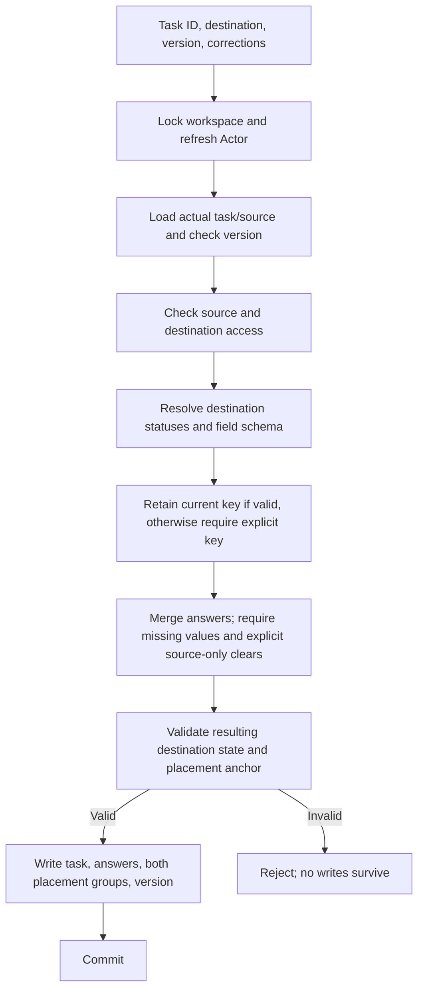

# Module: application workflows

Status: planned. Code owner: `libs/api/workflows`. Navigation: [hub](../README.md), [architecture](../architecture.md), [ADR-0005](../adr/0005-delivery-and-consistency.md).

## 1. Purpose and example

A workflow is the coordinator for one user action. Individual modules know their own rules, but a move needs several rules to agree before anything is saved.

Bob moves Fix login from Backlog to Delivery. The workflow checks both lists, chooses the destination's effective statuses/fields, verifies Bob's answers, and then changes task/list/status/values/order together. If one check fails, the task stays exactly where it was.

This module owns the order of checks and the all-or-nothing boundary. It adds no business table and must not become a second copy of status, field, permission, or task rules.

## 2. Ownership, data, and decisions

| Concern | Owner called by the workflow |
| --- | --- |
| Current active membership | Identity |
| Actual list/parent/archive state | Hierarchy |
| Read/edit/admin access | Permissions |
| Effective columns | Statuses |
| Effective inputs and valid answers | Custom fields |
| Task/version/assignments/answer rows/placement | Tasks |
| Transaction/snapshot and lock | Persistence |

No owned ER block exists because no workflow table exists. The [complete ER](../er-diagram.md) shows the referenced owners. Cross-table writes are performed through public owner services sharing the same transaction context; there are no direct sibling repository imports.

| Decision | Consequence |
| --- | --- |
| Workspace lock for domain writes | All task/config/container/grant mutations see a serial order within this small workspace. |
| Refresh membership/access inside transaction | An Actor from the HTTP guard is not the only authority for a later mutation. |
| Validate before persisting | Candidate configs and moves remain temporary until every affected record is checked. |
| Consistent board snapshot | Task keys/answers and the config used to interpret them come from one snapshot. |
| Separate auth transaction | Refresh uses session/token locks in identity, not the workspace write lock. |

The API guard establishes identity. A domain workflow then resolves the stored resource and its permissions; caller-supplied parent/list IDs cannot override a task's real source list. Grant changes use the same domain workspace lock as task/config writes. Requests already authorized before logout may finish; new requests cannot use a revoked session.

## 3. Connections and interfaces

Domain HTTP handlers call workflows. Workflows return transport-safe projections/errors through [API/contracts](api-contracts.md). Identity routes stay in identity. All allowed imports are explicit in [architecture](../architecture.md).

| Workflow | Result |
| --- | --- |
| Load tree/board/list/detail | Authorized projection only, with the relevant resolved config. |
| Create/update/archive/reorder task | One validated task mutation with version and placement updates. |
| Move task | One source/destination/config/value/placement mutation. |
| Change status/field configuration | Candidate checked against all affected retained tasks, then applied or rejected. |
| Administer containers/grants | Authorized structural/access change under the same lock. |

Board responses contain a complete resolved status/field configuration plus a task page. The web client loads all pages for the small selected-list dataset. Each page is internally consistent; if later pages reveal incompatible config or failed validation, discard/refetch rather than combine contradictory data. We do not claim one database snapshot persists across separate HTTP requests.

## 4. Workflows and sequence diagrams

### Load board, then drag a card

```mermaid
sequenceDiagram
    participant Web as React board
    participant Auth as Global identity guard
    participant Flow as Board workflow
    participant P as Hierarchy / permissions
    participant Config as Status / field resolvers
    participant T as Task service
    participant DB as Transaction coordinator
    Web->>Auth: GET selected-list board with access JWT
    Auth-->>Flow: Current Actor
    Flow->>DB: Begin consistent read snapshot
    Flow->>P: Check stored list and whole path
    Flow->>Config: Resolve columns and field schema
    Flow->>T: Query task page, assignments, values
    Flow->>DB: Finish snapshot
    Flow-->>Web: Config plus tasks and pagination
    Web->>Auth: Place card in another column with expectedVersion
    Auth-->>Flow: Actor
    Flow->>DB: Begin; lock workspace
    Flow->>P: Refresh membership, access, and active ancestors
    Flow->>Config: Validate destination status in current set
    Flow->>T: Check version/anchor; write status and positions
    Flow->>DB: Commit
    Flow-->>Web: Confirmed placement
```

The browser shows pending state while a mutation runs. It does not silently treat the card as saved. A failure keeps/refetches the server result and shows the actionable error. Optimistic conflict UI is not scheduled.

### Move between lists



```mermaid
sequenceDiagram
    participant Web as Move dialog
    participant Flow as Move workflow
    participant ID as Identity
    participant H as Hierarchy / permissions
    participant S as Status service
    participant F as Field service
    participant T as Task service
    participant DB as Transaction coordinator
    Web->>Flow: Destination, corrections, expectedVersion
    Flow->>DB: Begin and lock workspace
    Flow->>ID: Refresh active Actor
    Flow->>T: Load task, values, actual source, current version
    Flow->>H: Check both active lists and access
    Flow->>S: Resolve/validate destination status
    Flow->>F: Resolve schema and validate corrected answers
    alt All checks pass
        Flow->>T: Update list/status/answers/order/version atomically
        Flow->>DB: Commit
        Flow-->>Web: Same task ID in destination
    else Any check fails
        Flow->>DB: Roll back
        Flow-->>Web: 400, 403, 404, or 409; source unchanged
    end
```

Example: Backlog has in_progress and a customer_note. Delivery has building and a required release_date. Bob explicitly chooses building, supplies the date, clears customer_note, and may set verified=false. Shared effort/type/tags survive. Title/creator/assignments stay unchanged. No automatic mapping or silent answer loss occurs.

### Change configuration safely

```mermaid
sequenceDiagram
    participant Admin as Config screen
    participant Flow as Config workflow
    participant Owner as Status or field service
    participant H as Hierarchy
    participant T as Task queries
    participant DB as Transaction coordinator
    Admin->>Flow: Candidate edit/reset/delete
    Flow->>DB: Lock workspace; refresh Actor; require admin
    Flow->>Owner: Validate candidate itself without saving
    Flow->>H: Enumerate affected descendant lists, including archived branches
    Flow->>Owner: Resolve proposed effective configuration per affected list
    Flow->>T: Query retained usage and resulting task states
    Flow->>Owner: Validate all affected tasks against candidate
    alt All records stay valid
        Flow->>Owner: Persist candidate
        Flow->>DB: Commit
        Flow-->>Admin: Saved
    else In-use or incompatible
        Flow->>DB: Roll back
        Flow-->>Admin: 409 with blockers; original config intact
    end
```

Status impact skips descendants protected by a lower status override. Field impact follows additive ancestry. Never validate only the current UI page. Cosmetic label/order edits preserve stable keys/IDs. Invalid candidate structure itself is 400; an otherwise valid candidate that breaks stored tasks is 409.

## 5. Build phases, failure cases, and change guide

Create read/task workflows in Day 2 and config/admin workflows in Day 3. Controllers, curl, and future channels all use these same workflows. Implement tests on Day 4.

| ID | Test TODO: setup/action -> expected result |
| --- | --- |
| FLOW-01 | Board load -> authorize before returning columns/fields/tasks; consistent single-response snapshot. |
| FLOW-02 | Move lacks compatible status, required value, or explicit clear -> reject and preserve source task/answers/order/version. |
| FLOW-03 | Complete move corrections -> one commit, same ID, valid destination, preserved assignments/shared values. |
| FLOW-04 | Source/destination inaccessible or archived -> no data leak/mutation. |
| FLOW-05 | Config delete/reset/required change -> checks all retained affected tasks, respects lower overrides, no partial config write. |
| FLOW-06 | Task/config or task/grant race -> serial workspace order, no stale-validation commit. |
| FLOW-07 | Task version stale -> 409; unrelated auth refresh does not require workspace lock. |
| FLOW-08 | Failure injected between owned writes -> rollback every change. |
| FLOW-09 | Separate board pages straddle config change -> client refetches rather than assumes a cross-request snapshot. |

When changing a workflow, update the order diagram, transaction boundary, owner interfaces, HTTP contract, and failure example together. Do not move cross-domain validation into a task or config repository to simplify a controller.
